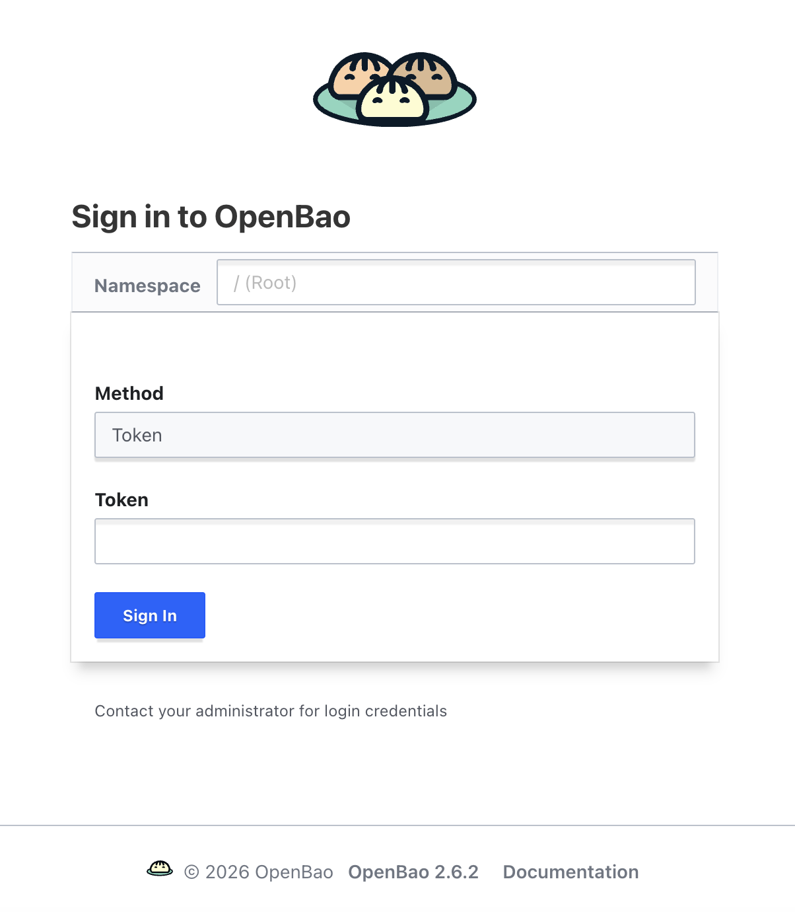
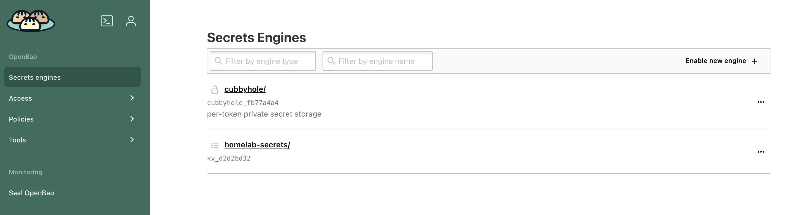
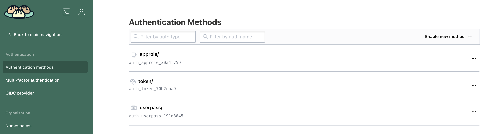
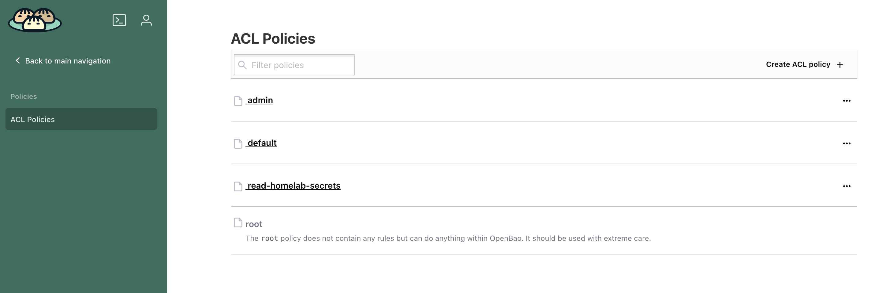

# Introduction

Now that I have ArgoCD up and running, I can continue building my homelab. I decided to focus on secrets management now, namely OpenBao. This is an important part because I need an application that works as a centralized secret manager that every other application can access to fetch a password, a token or some ssh key in order to do some taks. For example, the CI tool I will use, needs the git credentials to access either Gitlab or Gitea repositories, or access to Harbor to have access to image registry in order to push images there.

## Why OpenBao

I decided on OpenBao because it is open source with all the necessary features I need on my homelab. Besides, it is a fork of Hashicorp Vault, which I already worked on a few years ago, so it should feel familiar to me. Check the first article [1-Architecture_and_hardware (secrets management options)](1-Architecture_and_hardware.md#secrets-to-have-the-secrets-available-to-the-cluster-and-possibly-other-applications) for the reasons of this choice, but here is the overview:

 - OpenBao
   - Fork of Hashicorp Vault
   - Does what I need, which is manage secrets and it is easily available to other applications
   - Clear roadmap on the future features
   - Open source

# Preparing Reverse Proxy LXC so OpenBao is accessible

Like for the previous sections, I need to update the reverse proxy configuration so it allows access to the web UIs of OpenBao. The config will be added to [infrastructure/ansible/playbooks/update-reverse-proxy-config.yaml of my homelab](https://github.com/Joao-Andrade/homelab-devops/blob/v7/infrastructure/ansible/playbooks/update-reverse-proxy-config.yaml) and the new url will be:
 - http://openbao.internal

To do that I used the following command from the `management-node`, with the repository cloned:

```bash
# cd into infrastructure/ansible/playbooks
ansible-playbook update-reverse-proxy-config.yaml
```

# Deploying OpenBao on my Homelab

To deploy OpenBao, I will make use of ArgoCD. On the previous chapter [about ArgoCD](./6-Deploy_argocd.md#configure-argocd-application-sets), it was configured two Application Sets, one for stateful apps and one for stateless apps. I will deploy OpenBao as a stateful app so the pvcs are preserved if I mistakenly delete the ArgoCD application.

I created a custom helm chart based on the oficial one ([OpenBao](https://github.com/openbao/helm-charts/tree/main/charts/openbao)), where I just changed some of the values file. The configuration is available on my [homelab repository](https://github.com/Joao-Andrade/homelab-devops/tree/v7/infrastructure/helm-charts/argo-deploys/stateful/secrets-manager).

## OpenBao initialization and unseal process

Normally OpenBao starts sealed and requires the initialization and unsealing to be a manual process, but because I am deploying on a homelab, and it is not a production environment on a company, I decided to make the process automatic and make it ready to use right after deployment.

This chart automates the process with a small sidecar container (`auto-unseal`) that runs inside the same pod. On first boot it initializes OpenBao through its API and stores the unseal keys + root token in a Secret (`openbao-unseal-keys`). If it restarts, it reads that Secret and unseals automatically.

If this is not intended, it is always possible to change the Helm chart to remove the [template files](https://github.com/Joao-Andrade/homelab-devops/tree/v7/infrastructure/helm-charts/argo-deploys/stateful/secrets-manager/openbao/templates) and the volume `auto-unseal-script` and extra container `auto-unseal` from the [values file](https://github.com/Joao-Andrade/homelab-devops/blob/v7/infrastructure/helm-charts/argo-deploys/stateful/secrets-manager/openbao/values.yaml) before deploying.

## Deploying OpenBao on the kubernetes cluster

To deploy OpenBao, I just need to copy the [OpenBao folder with the helm chart](https://github.com/Joao-Andrade/homelab-devops/tree/v7/infrastructure/helm-charts/argo-deploys/stateful/secrets-manager/openbao) to the repository that ArgoCD is watching. For my homelab, I copied to Gitlab's repository to `infrastructure/helm-charts/argo-deploys/stateful/secrets-manager/openbao`. ArgoCD will notice the folder and deploy it on the cluster.

Once deployed, confirm the pods are running on the cluster:

```bash
kubectl --kubeconfig ~/.kube/homelab_cluster01 get pods -n openbao
```

Also confirmed that OpenBao was accessible through the browser on `http://openbao.internal`.



## Accessing OpenBao

Because the OpenBao initialization and unseal process is automatic (check [OpenBao initialization and unseal process](#openbao-initialization-and-unseal-process)), I can check the root token and unseal keys in the created secret:

```bash
kubectl get secret openbao-unseal-keys -n openbao --kubeconfig ~/.kube/homelab_cluster01 -o jsonpath='{.data.init-output}' | base64 -d
```

Used the root token to access OpenBao UI on `http://openbao.internal`.

## Initial OpenBao configuration

What I want from a secret manager is to allow me, as a user, to create and read secrets or another application I may create to read the secrets.

To do that on OpenBao, I need to configure a few things:

- Create a KV secret engine.
  - This is what will store the secrets as key values.
- Create the policies that allows me to create and read secrets.
  - A policy is a set of rules that determine what actions a user can perform on the secrets.
- Enable auth method userpass
  - This is what will allow to create users to log in with user and password.
- Enable auth method AppRole
  - This is what will allow applications to log in with AppRole.
- Create a user and an AppRole

From the management node, access OpenBao container (the CLI binary is `bao`):

```bash
# Enter OpenBao container
kubectl --kubeconfig ~/.kube/homelab_cluster01 -n openbao exec -it openbao-0 -- /bin/sh

# Export BAO_TOKEN
export BAO_TOKEN="<token>"

# Create KV engine - Change <root-path>
bao secrets enable -path=<root-path> kv-v2

# Create policy for admins
bao policy write admin - <<'EOF'
path "*" {
  capabilities = ["create", "read", "update", "delete", "list", "sudo"]
}
EOF

# Create policy for read secrets - Change <root-path>
bao policy write read-<root-path>-secrets <<'EOF'
path "<root-path>/data/*" {
  capabilities = ["read"]
}
path "<root-path>/metadata/*" {
  capabilities = ["list", "read"]
}
EOF

# Enable auth methods
bao auth enable userpass
bao auth enable approle

# Add user - Change <username> and <password>
bao write auth/userpass/users/<username> password=<password> token_policies=admin

# Create AppRole - Change <myapp> and <root-path>
bao write auth/approle/role/<myapp> token_policies=read-<root-path>-secrets token_ttl=1h token_max_ttl=4h
# Show role id
bao read auth/approle/role/<myapp>/role-id
# Generate secret id
bao write -f auth/approle/role/<myapp>/secret-id
```

It is possible to confirm on the UI. From the side menu, the `Secrets Engines` should show the secrets engines, the `Access` should show authentication methods and `Policies` should show the ACL policies.







Now I can access on the UI with the user and password created and I can use the App role the following way, from inside the OpenBao container:

```bash
# Access container, if not already, from management-node
kubectl --kubeconfig ~/.kube/homelab_cluster01 -n openbao exec -it openbao-0 -- /bin/sh

# Login with Approle
bao write auth/approle/login role_id=<role-id> secret_id=<secret-id>
# This returns a token

# Get a secret that already exists - Should work
BAO_TOKEN=<token> bao kv get <root-path>/secret

# Put a secret - Should not work because of policy
BAO_TOKEN=<token> bao kv put <root-path>/secret foo=bar
```

## Resource consumption

Because I set up the pods with specific resource limits and requests, I know the maximum resource consumption OpenBao can have. I could give more resources but I think the following should be enough for my homelab.

- requests:
  - cpu: 100m
  - memory: 256Mi
- limits:
  - cpu: 500m
  - memory: 512Mi

This means on high workloads, Openbao will use 500m of CPU and 512 Mi of memory.

# Cleaning up OpenBao installations

In this section I will explain how to uninstall OpenBao from the cluster.

The first thing need to do is to remove OpenBao helm chart folder from gitlab repository. This way ArgoCD will notice the change (may take a few minutes) and remove OpenBao from the cluster.

Then from the command line, from a server that has connection to the cluster, like the `management-node`, I need to check all the resources that were not cleaned by ArgoCD:

```bash
# Check if namespace exists
kubectl get namespace --kubeconfig ~/.kube/homelab_cluster01

# Check that all OpenBao pods are deleted:
kubectl --kubeconfig ~/.kube/homelab_cluster01 get pods -A

# Check other OpenBao resources:
kubectl --kubeconfig ~/.kube/homelab_cluster01 -n openbao get secrets,pvc,pv,configMaps

# Check resources not in the namespace:
kubectl get clusterrole,clusterrolebinding,mutatingwebhookconfiguration,validatingwebhookconfiguration,crd --kubeconfig ~/.kube/homelab_cluster01 | grep -i openbao
```

Deleted whatever resource found on previous commands.

Finally deleted the namespace:

```bash
kubectl --kubeconfig ~/.kube/homelab_cluster01 delete namespace openbao
```

# Next steps

Now that I have a secrets manager, I can move to the next step, which is deploying an image registry so I can create and store Docker images. I will compare Harbor against the registries available on Gitea and Gitlab. Check the next article [8 - Registry: Harbor vs git registries](./8-Registry_harbor_vs_git_registries.md).

# Articles

Here's the full list of articles of this series:

 - [1 - Architecture and Hardware](./1-Architecture_and_hardware.md)
 - [2 - Install Proxmox](./2-Install_proxmox.md)
 - [3 - Create and configure LXCs](./3-Create_and_conf_LXCs.md)
 - [4 - Create and configure VMs](./4-Create_and_conf_VMs.md)
 - [5 - Git: Gitlab vs Gitea](./5-Git_gitlab_vs_gitea.md)
 - [6 - Deploy ArgoCD](./6-Deploy_argocd.md)
 - [7 - Secrets: Deploy OpenBao](./7-Secrets_openbao.md)
 - [8 - Registry: Harbor vs git registries](./8-Registry_harbor_vs_git_registries.md)
 - [9 - CI tools: Jenkins vs git runners](./9-CI_tools_jenkins_vs_git_runners.md)
 - [10 - Git server, registry and CI tool: the decision](./10-Git_registry_ci_tool_the_decision.md)
 - [11 - Code quality: Sonar, Trivy, Semgrep](./11-Code_quality_sonar_trivy_semgrep.md)
 - [12 - CI/CD](./12-CICD.md)
 - [13 - Observability: Grafana, Prometheus, Loki, Jaeger, SigNoz](./13-Observability_grafana_prometheus_loki_jaeger_sigmoz.md)
 - [14 - Conclusions](./14-Conclusions.md)
