# Introduction

Now that I have a secrets manager, I can deploy an image registry. I need one to store the container images and helm charts of the applications I use or some custom applications I may create. In this article I will enable and compare the registries of Gitlab, Gitea and Harbor.

With a registry, for the applications that I do not create, the cluster can pull images from public repositories and store on my private repositories. That way, if the public repositories, for some reason become unavailable, the images that each application requires are still available to the cluster.

## What I will compare in this article

To compare the three registries, I will compare the following metrics:

 - Resource consumption (CPU and memory)
 - Pushing and pulling two container images, one small and another bigger.
 - Pushing and pulling two Helm charts, one small and another bigger.
 - Layers. What happens on shared layers?
 - Cleanup and garbage collection. If I delete tags, how long to free space? How to keep only N versions?

# Pre-requisites

There are three actions needed before using the registries:

 - Preparing the Reverse Proxy LXC
 - Preparing the hosts file
 - Preparing docker engine

## Preparing Reverse Proxy LXC so the registries are accessible

Registries push large image layers, so the reverse proxy needs to accept big request bodies and not buffer them. Like on the previous articles, the config is on [infrastructure/ansible/playbooks/update-reverse-proxy-config.yaml of my homelab](https://github.com/Joao-Andrade/homelab-devops/blob/v8/infrastructure/ansible/playbooks/update-reverse-proxy-config.yaml) and the new urls will be:

 - http://registry.gitlab.internal
 - http://harbor.internal
 - Gitea uses the already configured http://gitea.internal

To do that I used the following command from the `management-node`, with the repository cloned:

```bash
# cd into infrastructure/ansible/playbooks
ansible-playbook update-reverse-proxy-config.yaml
```

## Preparing the hosts file

Like on the previous articles, the computer that will access the registries needs the new hostnames in its `/etc/hosts` file:

```bash
192.168.1.81 registry.gitlab.internal harbor.internal
```

## Preparing Docker engine

To compare each registry, I will try to use my computer to connect to the registries. Because none of the registries, or git servers, has TLS configured, I need to edit Docker settings to accept insecure registries. Since I am on Mac, I edited `~/.docker/daemon.json` and added the following content, but if on another system, the approach may be different (for example `/etc/docker/daemon.json` on Linux):

```json
{
  "insecure-registries": [
    "registry.gitlab.internal",
    "gitea.internal",
    "harbor.internal"
  ]
}
```

Then restart Docker (on Docker Desktop, restart it from the menu; on Linux, for example `sudo systemctl restart docker`).

# Deploying the registries on my Homelab

Like for OpenBao on the previous article, I will use ArgoCD to deploy Harbor. For Gitlab and Gitea registries, because they were deployed before ArgoCD, I need to re deploy the helm charts with the registries enabled.

## Gitlab registry

Since Gitlab was already deployed, I just need to change the helm chart values file to enable the registry. The path to the value is `gitlab.registry.enabled: true`.

Because this was not deployed with ArgoCD, I needed to re-deploy it manually with the helm commands. From the `management-node`, with the repository cloned:

```bash
cd infrastructure/helm-charts/source-control/gitlab
helm dependency update
helm upgrade --install gitlab . --kubeconfig ~/.kube/homelab_cluster01 --namespace gitlab --create-namespace --wait
```

In order to push and pull from Gitlab registry, I need to have a user with the right permissions. On Gitlab go to profile on top right -> Preferences. On the left menu click on Access -> Personal access tokens. Then click on "Add new token" on top right.

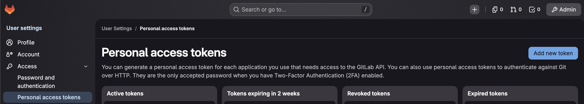

I created a token with the `read_registry`, `write_registry`, `api` and `read_api` permissions.

The token generated is going to be used to log in with Docker, with the GitLab username (`root`) and the token as the password: `docker login registry.gitlab.internal`.

### Cleanup rule for Gitlab registry

In order to not have an infinite number of images on the registry, it is possible to create a cleanup rule so Gitlab auto manages the versions of each image and keep only the last x versions. To do that, on Gitlab, navigate to the repository that will contain the Docker images and Helm charts. Then on the left side menu click on `Settings` -> `Package and Registries`. On the `Container registry`, there is the option to `Add a cleanup rule`.

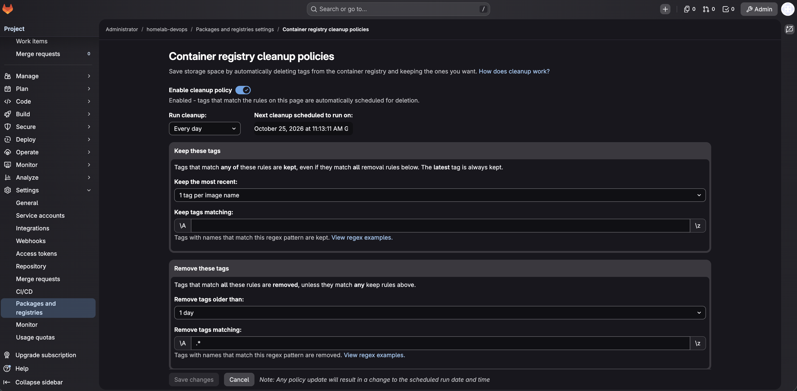

## Gitea registry

For Gitea, it is not necessary to do anything as the registry is already enabled by default.

Like for Gitlab, it is necessary to create a token to push and pull from Gitea registry. On Gitea, go to profile on top right -> Settings. On the left menu click on Applications.

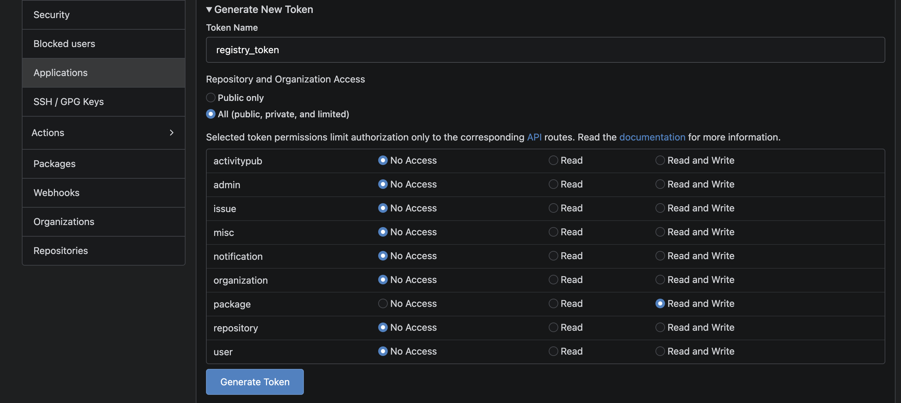

I created a token with the `Read and Write` permissions for `package`.

The token generated is going to be used to log in with Docker, with the Gitea username (`gitea`) and the token as the password: `docker login gitea.internal`.

### Cleanup rule for Gitea registry

Like for Gitlab, I don't want to have an infinite number of images on the registry, so I need to create a cleanup rule so Gitea auto manages the versions of each image and keep only the last x versions. To do that, on Gitea, click on the profile icon on top right -> Settings. Then on the side menu click on `Packages`. On the page should appear the option to create a cleanup rule where it is possible to specify a few rules, including the number of versions or number of days to keep a version. For docker images and helm charts uploaded using OCI, select the `Container` type and for Helm charts pushed via API ,select the `Helm` type (Note that if pushing Helm charts with OCI, which is the new standard format, then it will be on the `container` type, but if using the classic approach, then it will appear as a `helm` type).

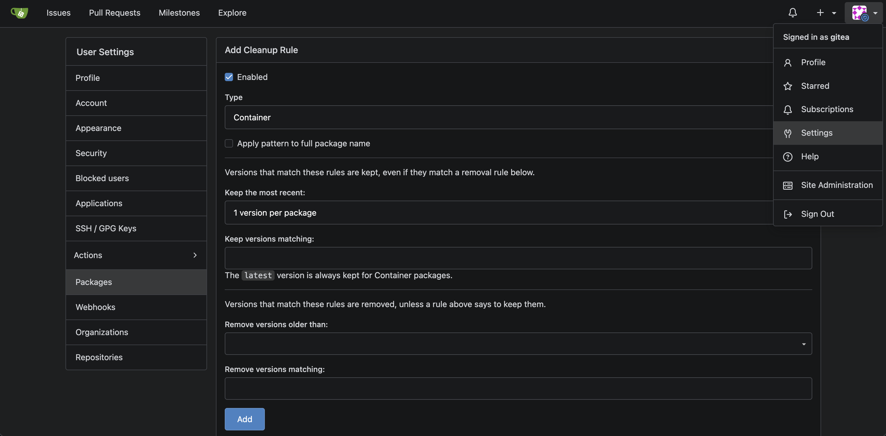

## Harbor

Harbor is made of several components (core, portal, registry, job service, database, Redis and the Trivy scanner), so I expect it to be the heaviest option. I created a wrapper helm chart around the [official Harbor chart](https://github.com/goharbor/harbor-helm). The helm chart has no TLS, has Trivy enabled and uses an internal database.

### Deploying Harbor on the kubernetes cluster

To deploy Harbor, I just need to copy the [Harbor folder with the helm chart](https://github.com/Joao-Andrade/homelab-devops/tree/v8/infrastructure/helm-charts/argo-deploys/stateful/registry/harbor) to the repository that ArgoCD is watching. For my homelab, I copied it to Gitlab's repository, to `infrastructure/helm-charts/argo-deploys/stateful/registry/harbor`. ArgoCD will notice the folder and deploy it on the cluster.

Once deployed, confirm the pods are running on the cluster:

```bash
kubectl --kubeconfig ~/.kube/homelab_cluster01 get pods -n harbor
```

Also confirmed that Harbor was accessible through the browser on `http://harbor.internal`.

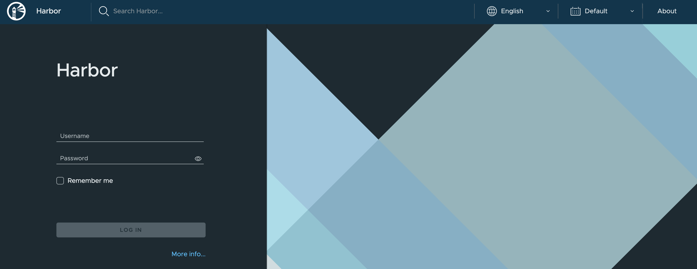

### Creating a project on Harbor

A project is a space on Harbor where it can store the Images, Helm charts or other artifacts. On side menu of the Harbor UI, click on `Projects` and then on `+ New Project` to create a new project, which I named `homelab-registry` (the name used by the test scripts). For the options, I selected the project as private so there is only a login even for pulling images, the quota limit is set to unlimited and it is not a proxy registry.

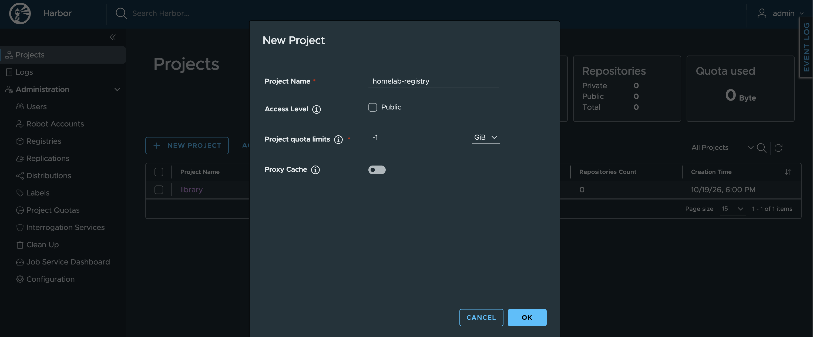

### Creating a robot account

A robot account is what can be used by applications or scripts to perform actions on Harbor. For my homelab, I need a robot account so a CI/CD pipeline or the cluster can push and pull images from Harbor.

To create a robot account, on Harbor UI, go to the project created on the previous step and select the tab `Robot Accounts` and click on `+ New Robot Account` icon on top right to create a new robot account.

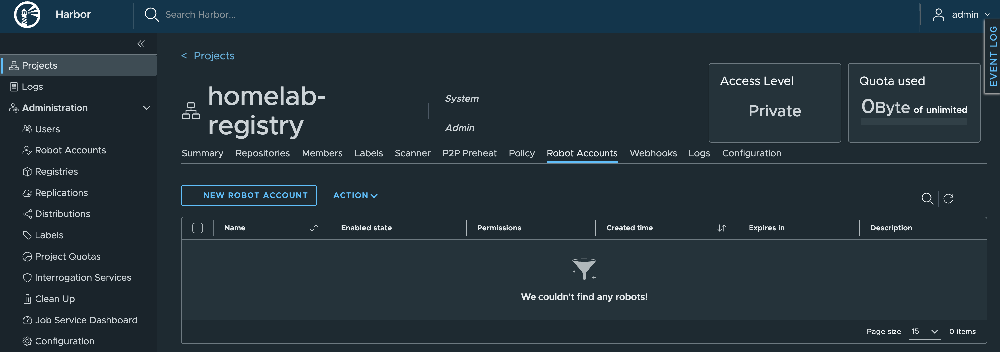

For the basic information I defined to not expire.

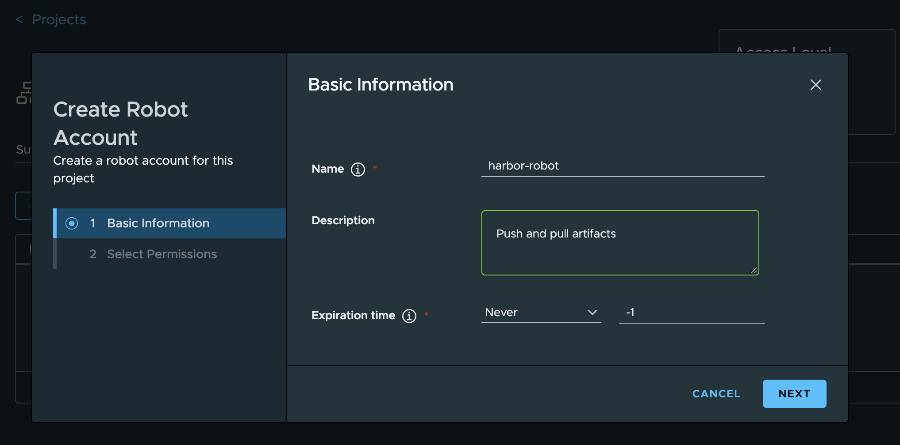

For the permissions, I selected the following:

 - Artifact: Read and List
 - Repository: Read, Pull, Push, List and Update
 - Tag: Create and List

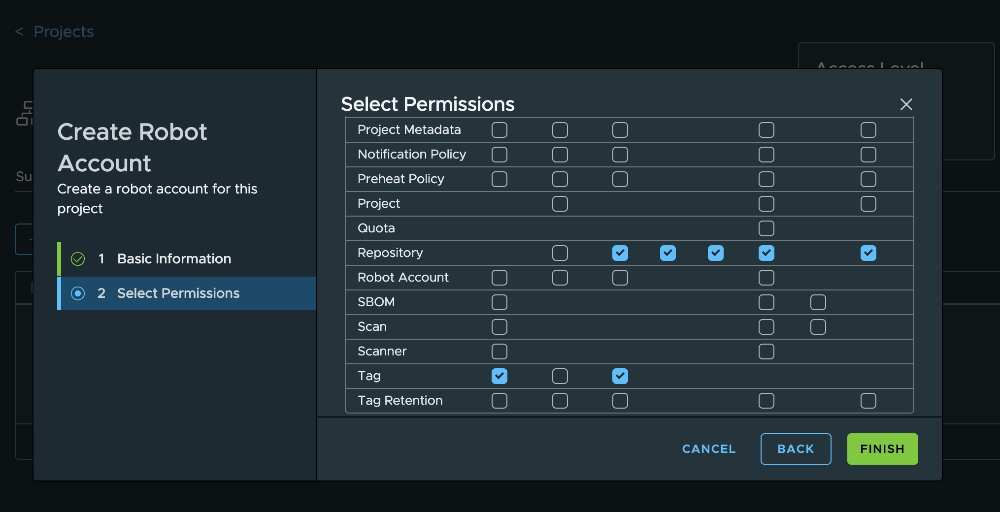

After that the robot account is created and it should appear the token and username to be used to login on the registry: `docker login harbor.internal`, with the robot account name as the username and the generated token as the password.

### Cleanup rule for Harbor

For Harbor, I want to create a cleanup rule, just like I did for Gitea and Gitlab, in order to not have unlimited number of images or tags. I just want to have one or two tags for each Docker image or Helm Chart.

To do that, on Harbor, I went to the project created on the previous step and selected the tab `Policy` and clicked on `Add rule` button to create a new cleanup rule.

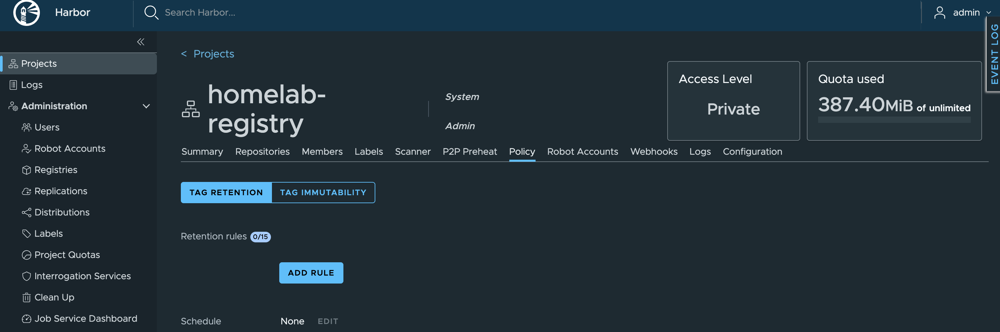

The only setting I set for now is the number of tags to keep is 1.

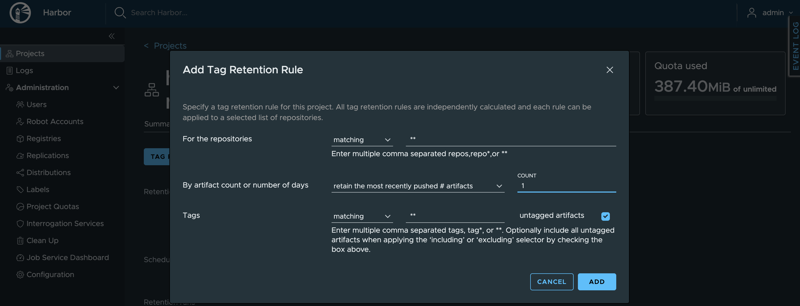


# Comparing the registries

In this section I will describe all the tests I performed on the registries. Because I want to test how fast each registry handles some tasks, I decided to create a script to do most of the tests. I could also do them manually via command line.

## Resource consumption

To compare the resource consumption, when Idle, I let all three applications running for 1 hour. Of course, as Gitlab and Gitea are not only a registry, I cannot really understand how much impact the registry has on the overall consumption of the git servers. But, it is interesting to compare them all anyway.

For the comparison, I used the following command:

```bash
kubectl top pods -A
```

This returns the memory and CPU usage by all pods on the cluster. Regarding the registries, here are the results:

| Registry | Pod | CPU (cores) | Memory (Mi) |
|----------|-----|-------------|-------------|
| gitea      | gitea-xxxx                          | 2m           | 138Mi |
| gitlab     | gitlab-gitaly-0                     | 3m           | 465Mi |
| gitlab     | gitlab-gitlab-shell-xxxx            | 8m           | 65Mi |
| gitlab     | gitlab-minio-xxxx                   | 1m           | 23Mi |
| gitlab     | gitlab-postgresql-0                 | 5m           | 235Mi |
| gitlab     | gitlab-redis-master-0               | 14m          | 62Mi |
| gitlab     | gitlab-registry-xxxx-1              | 1m           | 93Mi |
| gitlab     | gitlab-registry-xxxx-2              | 1m           | 35Mi |
| gitlab     | gitlab-sidekiq-all-in-1-v2-xxxx     | 37m          | 1620Mi |
| gitlab     | gitlab-toolbox-xxxx                 | 1m           | 1Mi |
| gitlab     | gitlab-webservice-default-xxxx      | 13m          | 2399Mi |
| harbor     | harbor-core-xxxx                    | 1m           | 43Mi |
| harbor     | harbor-database-0                   | 4m           | 83Mi |
| harbor     | harbor-jobservice-xxxx              | 2m           | 13Mi |
| harbor     | harbor-portal-xxxx                  | 1m           | 4Mi |
| harbor     | harbor-redis-0                      | 3m           | 8Mi |
| harbor     | harbor-registry-xxxx                | 1m           | 21Mi |
| harbor     | harbor-trivy-0                      | 1m           | 7Mi |

As it is possible to see, Gitea consumes about 2m of CPU and 138Mi of memory. Gitlab consumes in total about 84m of CPU and 4998Mi of memory. Harbor consumes in total about 13m of CPU and 179Mi of memory. Gitlab consumes way more than the other two combined.

## Pushing and pulling Docker images

One task I can do to directly to compare the registries, is to check how much time it takes to push and pull two Docker images of different sizes, one small and one big, on each registry.

 - Small image: alpine:3.20 (approx 3.9 MB)
 - Big image: python:3.12 (approx 383 MB)

To do this I created two scripts (`registry-tests-push.sh` and `registry-tests-pull.sh`) that can be accessed [on my homelab Github repository](https://github.com/Joao-Andrade/homelab-devops/tree/v8/scripts/management-node/testing-apps/registry). But on a summary, the push script does the following actions. **IMPORTANT** I did docker login on each registry before executing the script:

```bash
DOCKER_SMALL_IMAGE="alpine:3.20"
DOCKER_BIG_IMAGE="python:3.12"

# Pull images
docker pull $DOCKER_SMALL_IMAGE
docker pull $DOCKER_BIG_IMAGE

# Retag to registries
docker tag $DOCKER_SMALL_IMAGE gitea.internal/gitea/homelab-devops/$DOCKER_SMALL_IMAGE
docker tag $DOCKER_BIG_IMAGE gitea.internal/gitea/homelab-devops/$DOCKER_BIG_IMAGE
docker tag $DOCKER_SMALL_IMAGE registry.gitlab.internal/root/homelab-devops/$DOCKER_SMALL_IMAGE
docker tag $DOCKER_BIG_IMAGE registry.gitlab.internal/root/homelab-devops/$DOCKER_BIG_IMAGE
docker tag $DOCKER_SMALL_IMAGE harbor.internal/homelab-registry/$DOCKER_SMALL_IMAGE
docker tag $DOCKER_BIG_IMAGE harbor.internal/homelab-registry/$DOCKER_BIG_IMAGE

# Push to registries
docker push gitea.internal/gitea/homelab-devops/$DOCKER_SMALL_IMAGE
docker push gitea.internal/gitea/homelab-devops/$DOCKER_BIG_IMAGE
docker push registry.gitlab.internal/root/homelab-devops/$DOCKER_SMALL_IMAGE
docker push registry.gitlab.internal/root/homelab-devops/$DOCKER_BIG_IMAGE
docker push harbor.internal/homelab-registry/$DOCKER_SMALL_IMAGE
docker push harbor.internal/homelab-registry/$DOCKER_BIG_IMAGE
```

After each run, I deleted the images from the registries and re ran the script again for about four times. This can give me an average of the time it takes to push to each repository.

As of pulling from the registries, I pulled the images from each registry about four times as well to have an average. Note that after each pull, I clean the local docker registry, so it fully pulls each image at each pull.

The results are the following:

| Image | Gitea | Gitlab | Harbor |
|-------|-------|--------|--------|
| alpine:3.20 push | 7s | 6s | 7s |
| alpine:3.20 pull | 7s | 6s | 7s |
| python:3.12 push | 65s | 61s | 64s |
| python:3.12 pull | 52s | 55s | 53s |

Please note that these values could be different, if the computer specifications are different, either the mini PC or the PC pulling or pushing the images. It can also vary if the connection speed between the machines are different or if the cluster is under a lot of load.

Regardless of that, the values are pretty similar and for a simple homelab, it is not because of a few seconds difference between them that I will make a decision.

## Pushing and pulling a Helm chart

For Helm charts, I did a similar test as for Docker images. I tried to push and pull two Helm charts, one big and another smaller, for each registry. Since most helm charts are small (<1MB) I pushed and pulled two helm charts to each registry, but didn't register how long it takes to do so on each registry as all of them were fast. The helm charts were:

 - oci://registry-1.docker.io/bitnamicharts/nginx with version 25.2.12 (60.19 kB)
 - oci://ghcr.io/prometheus-community/charts/kube-prometheus-stack with version 92.14.0 (931.8 kB)

## Features

### Layers

One test I wanted to do was checking if I deployed images that had the same layers as another image previously uploaded, if the registry would generate a new layer or if would use the layer already existing on the registry. To do that, I tried to deploy two versions of Python image, 3.12 and 3.11. These two images share some layers. As it can be seen on the following images, the registries manage this properly by reusing existing layers.

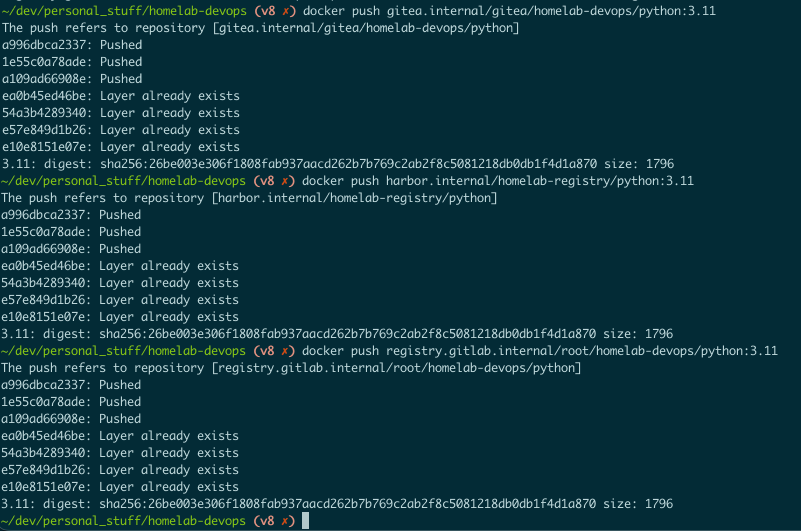

### Cleanup process

Each registry has the ability to create clean up or retention policies. This is useful to only maintain images or tags that follow certain rules. All of them allow to create rules based on the latest amount of tags or older than an amount of time or filter by tag. The frequency of this can be customized on each registry, when setting up each cleanup policy or on the same page that allows to create cleanup policies. I set it to once a day to verify that it works.

To verify this, I uploaded four versions of two Docker image (alpine:3.17 to 3.20 and Python:3.12 to 3.9. Yes the order is reversed, to confirm the cleanup cleans the oldest tags uploaded and not the ones with lower version numbers) to each registry and set up the cleanup policy to keep only the latest tag of each image. On the next day I verified that on each registry, only the latest tag deployed was kept (alpine:3.20 and python:3.9).

One note though. If I manually delete the images from the UI, only Gitea actually removes the image and its layer from the registry immediately. Both Gitlab and Harbor only sets the image and its layers to be removed, and removes it from the UI, but the layers are actually removed when their garbage collection is run. These are two different approaches to the cleanup process internally, and both are valid. For me, I don't mind either way as long as the images are removed and frees disk space.

# Conclusion

As it was possible to see, all three of them work as expected and provide similar times to upload and pull Docker images and Helm charts. There are some advantages and disadvantages to each:

Gitea:
 - Advantages:
   - Already included, no extra pods which means it is very lightweight.
   - Can store multiple package types, like Docker images, Helm charts, Maven, PyPI.
 - Disadvantages:
   - Packages are pushed to the user and then needs to be manually attached to a repository (not mentioned on this article how to, as I don't think it is relevant for now).
   - No proxy cache for Docker hub or other public repositories.
   - No vulnerability scanner, which makes me need to have whatever scanner installed separately.

Gitlab:
 - Advantages:
   - Each project can have its own registry.
   - Easy to integrate with Gitlab Runners, if I use them.
   - Can have a cleanup process per project.
 - Disadvantages:
   - Makes it necessary to have Gitlab, which is very heavy.
   - Manual cleanup process is not straightforward as the other two options.

Harbor:
 - Advantages:
   - Has built in vulnerability scanner, which is a big plus.
   - Dedicated registry, meaning I can switch to whatever git server and still have the registry.
   - proxy cache for Docker hub or other public repositories.
 - Disadvantages:
   - Another deployment to manage and keep updated, although combined with Gitea is still not as heavy as Gitlab.

Based on my personal experience and with the small comparisons I did, I am inclined towards the Gitea plus Harbor configuration, as that can give me the best of both worlds, with minimal overhead. Gitea is responsible for the git server part and Harbor to the registry part. But before a decision, I need to evaluate the CI tools next and if I decide Gitlab CI and Gitlab Runners are the best solution for CI, I may only use Gitlab instead.

# Cleaning up the registries

## Cleaning Gitea registry

To cleanup Gitea registry, only a couple of actions needs to be done.

- Remove any image or helm chart pushed to the registry
- Remove token used to push/pull to Gitea registry
  - In order to remove the token created, on Gitea, go to profile on top right -> Settings. On the left menu click on Applications and delete the token.
- Remove the cleanup rule
  - To remove any cleanup rule created, on Gitea, click on the profile icon on top right -> Settings. Then on the side menu click on `Packages`. On the page, there should appear any cleanup rule created. Click on each cleanup rule to go to the edit page, where should appear a button to delete.

Since the Registry is active by default on Gitea, whether it is used or not, there is no need to change the Gitea Helm chart.

## Cleaning Gitlab registry

To cleanup Gitlab, a few actions are necessary.

- Remove any image or helm chart pushed to the registry.
- Remove token used to push/pull to Gitlab registry
  - In order to remove the token created, on Gitlab, go to profile on top right -> Preferences. On the left menu click on Access -> Personal access tokens. Then the token should be visible, with a button on the right that allows to delete.
- Remove the cleanup rule
  - In order to remove any cleanup rule created, on Gitlab, navigate to the repository that contains the cleanup rules. Then on the left side menu click on `Settings` -> `Package and Registries`. On the `Container registry`, there is the option to `Edit cleanup rule`. On the page, click on the option to disable the rule and then `save changes`.
- Edit Gitlab Helm chart values to disable the registry
  - The helm chart values file has a `registry` section under `gitlab`, which can be used to disable the registry. In order to disable it, set `gitlab.registry.enabled` to `false` and then, since this was not deployed with ArgoCD, re-deploy it manually with the helm commands. From the `management-node`, with the repository cloned:
    ```bash
    cd infrastructure/helm-charts/source-control/gitlab
    helm dependency update
    helm upgrade --install gitlab . --kubeconfig ~/.kube/homelab_cluster01 --namespace gitlab --create-namespace --wait
    ```

## Cleaning Harbor registry

To cleanup Harbor, a few actions are necessary. It is necessary to remove it from ArgoCD and then cleanup the cluster.

To remove from ArgoCD, it is only necessary to remove the folder from the repository and wait for ArgoCD to sync. Since I created the folder on Gitlab's repository `infrastructure/helm-charts/argo-deploys/stateful/registry/harbor`, I just remove the folder and wait for the sync.

After ArgoCD syncs, it is possible to see that Harbor is no longer deployed, but there are still resources on the cluster that need to be removed.

From the `management-node`, with the repository cloned:

```bash
# Check if namespace exists
kubectl get namespace --kubeconfig ~/.kube/homelab_cluster01

# Check that all harbor pods are deleted:
kubectl --kubeconfig ~/.kube/homelab_cluster01 get pods -A

# Check other harbor resources:
kubectl --kubeconfig ~/.kube/homelab_cluster01 -n harbor get secrets,pvc,pv,configMaps

# Check resources not in the namespace:
kubectl get clusterrole,clusterrolebinding,mutatingwebhookconfiguration,validatingwebhookconfiguration,crd --kubeconfig ~/.kube/homelab_cluster01 | grep -i harbor
```

Delete every resource the previous commands show that belongs to Harbor.

After that, remove the namespace:

```bash
kubectl --kubeconfig ~/.kube/homelab_cluster01 delete namespace harbor
```

# Next steps

Now that I have a registry, I can compare CI tools, namely Jenkins against the CI of the git servers (Gitlab CI, Gitea Actions), to build the images and push them to the registry. Check the next article [9 - CI tools: Jenkins vs git runners](./9-CI_tools_jenkins_vs_git_runners.md).

# Articles

Here's the full list of articles of this series:

 - [1 - Architecture and Hardware](./1-Architecture_and_hardware.md)
 - [2 - Install Proxmox](./2-Install_proxmox.md)
 - [3 - Create and configure LXCs](./3-Create_and_conf_LXCs.md)
 - [4 - Create and configure VMs](./4-Create_and_conf_VMs.md)
 - [5 - Git: Gitlab vs Gitea](./5-Git_gitlab_vs_gitea.md)
 - [6 - Deploy ArgoCD](./6-Deploy_argocd.md)
 - [7 - Secrets: Deploy OpenBao](./7-Secrets_openbao.md)
 - [8 - Registry: Harbor vs git registries](./8-Registry_harbor_vs_git_registries.md)
 - [9 - CI tools: Jenkins vs git runners](./9-CI_tools_jenkins_vs_git_runners.md)
 - [10 - Git server, registry and CI tool: the decision](./10-Git_registry_ci_tool_the_decision.md)
 - [11 - Code quality: Sonar, Trivy, Semgrep](./11-Code_quality_sonar_trivy_semgrep.md)
 - [12 - CI/CD](./12-CICD.md)
 - [13 - Observability: Grafana, Prometheus, Loki, Jaeger, SigNoz](./13-Observability_grafana_prometheus_loki_jaeger_sigmoz.md)
 - [14 - Conclusions](./14-Conclusions.md)
