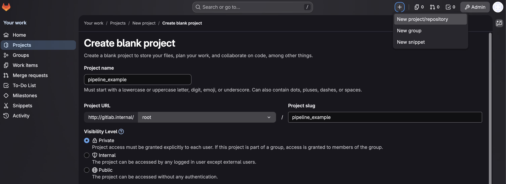
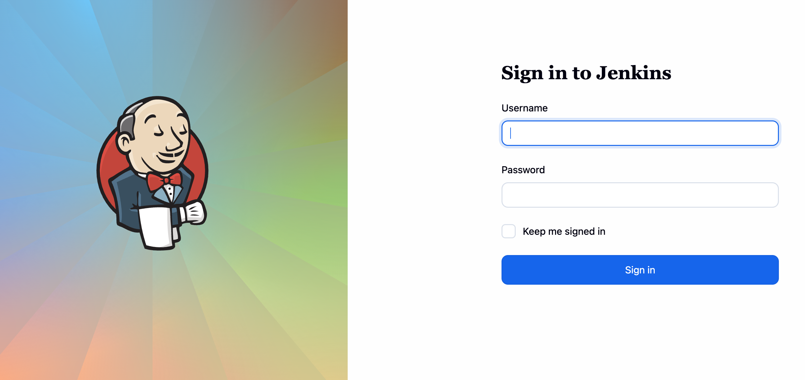
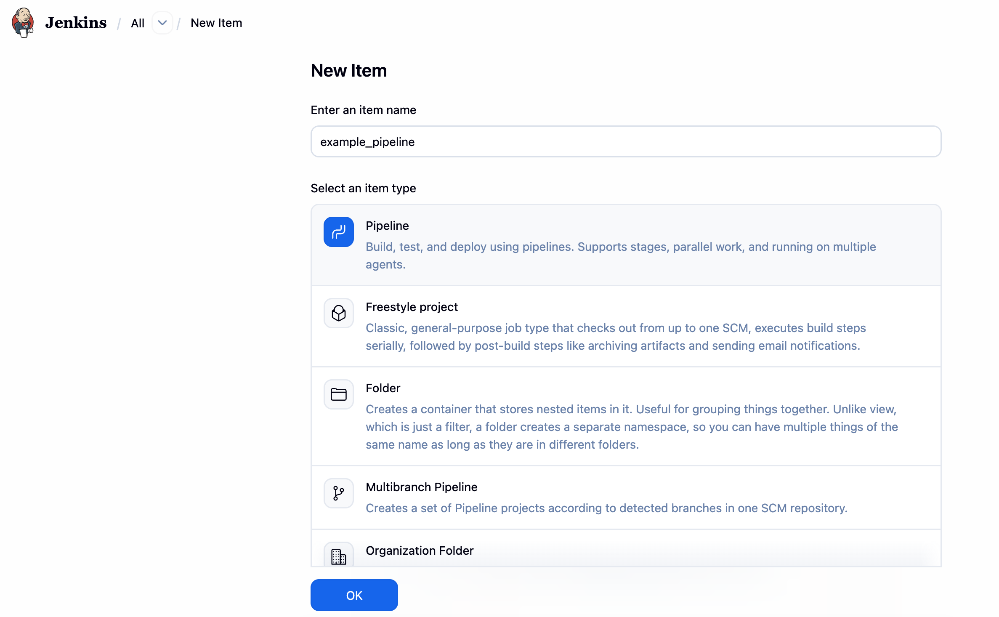
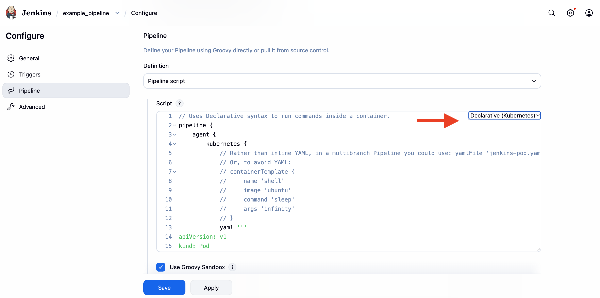
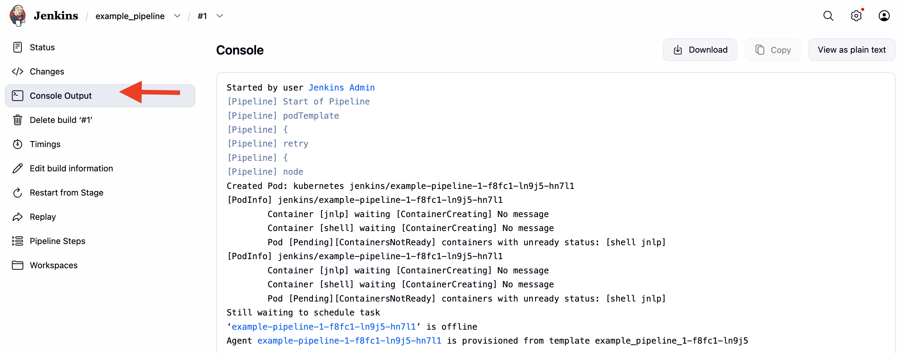

# Introduction

Now that I have git servers, a secrets manager and an image registry, I can start working on the CI part of my pipeline. In this article I will deploy three CI options and compare them to decide which one suits best my homelab: Jenkins, GitLab Runner (which executes the GitLab CI pipelines) and the Gitea Actions runner (which executes the Gitea Actions workflows).

A CI (Continuous Integration) tool is a very important part of a CI/CD pipeline. Every time someone pushes a change to a repository, it is responsible for at least checking out the code, building it, testing it, creating the container image and pushing it to the registry. Check the first article [1-Architecture_and_hardware (CI options)](./1-Architecture_and_hardware.md#ci-continuous-integration-so-when-a-new-commit-is-done-on-the-repos-the-workflow-runs) for the reasons of each choice, but here is the overview:

 - Jenkins
   - Industry standard, has a lot of plugins and it is very good for CI/CD.
   - Independent of the git server
 - Gitlab CI and GitLab Runner
   - Already part of GitLab, so it integrates well with Gitlab, both the repository and the registry
   - Uses Gitlab Runners to run the jobs
 - Gitea Actions and the Gitea runner
   - Same reason as GitLab, since it already has a registry and a git server, why not use the CI tool as well
   - Workflow and sintax is very similar to Github Actions, so it should be easy to move from Github repos to Gitea repos.

## What I will compare in this article

To compare the three CI tools, I will compare the following:

 - Resource consumption (CPU and memory) when idle
 - How simple it is to write the pipeline for the same simple example
 - How jobs are executed. How many pods does each one create to run the job?
 - Integration with Gitlab, Gitea, and Harbor
 - Create a simple CI pipeline that, from a repository on both Gitea and Gitlab, checkos out the code, builds an image and pushes to the registry, while fetching the credentials from OpenBao 

Whichever CI tool I choose, it will be part of my complete CI/CD pipeline that I will create in the [12 - CI/CD](./12-CICD.md) article.

# Pre-requisites

There are a few actions needed before deploying the CI tools:

 - Preparing the Reverse Proxy LXC (only Jenkins needs it, as the runners have no web UI)
 - Preparing the hosts file
 - Creating the secrets for **TODO** Jenkins And maybe for gitea and gitlab Runners

## Preparing Reverse Proxy LXC so Jenkins is accessible

Like on the previous articles, I need to update the reverse proxy configuration to access the Jenkins web UI. The config is on [infrastructure/ansible/playbooks/update-reverse-proxy-config.yaml of my homelab](https://github.com/Joao-Andrade/homelab-devops/blob/v9/infrastructure/ansible/playbooks/update-reverse-proxy-config.yaml) and the new url will be:

 - http://jenkins.internal

To apply the change to the reverse proxy, I excuted the following command from the `management-node`, with the repository cloned:

```bash
# cd into infrastructure/ansible/playbooks
ansible-playbook update-reverse-proxy-config.yaml
```

## Preparing the hosts file

The computer that will access Jenkins needs the new hostname in its `/etc/hosts` file, if on a Mac or Linux machine. For windows it may be a dfferent method. Appended it to the line that already points to the reverse proxy IP:

```bash
192.168.1.81 jenkins.internal
```

## Creating the secrets for Jenkins

### Admin account secret

In order to access Jenkins, it is necessary to have some admin account. This can be achieved on two ways. The simple one, that I do not recommend, is setting it on the values file of the Chart, [Jenkins helm chart folder on my repository](https://github.com/Joao-Andrade/homelab-devops/tree/v9/infrastructure/helm-charts/argo-deploys/stateful/ci/jenkins). The values on the values file are:

```bash
jenkins:
  controller:
    admin:
      createSecret: true
      username: "admin"
      # REPLACE the placeholder before deploying
      password: "<set-a-password>"
```

The other option, is to create manually a Kubernetes secret on the cluster, that will contain the credentials. That way, the creentials are not stored on git, even by mistake.

To create the secret, on the management node:

```bash
kubectl create namespace jenkins --kubeconfig ~/.kube/homelab_cluster01
# REPLACE the placeholder before deploying
kubectl create secret generic jenkins-admin -n jenkins --kubeconfig ~/.kube/homelab_cluster01 \
  --from-literal=jenkins-admin-user=admin \
  --from-literal=jenkins-admin-password=<password>
```

On the values file of the [Jenkins helm chart](https://github.com/Joao-Andrade/homelab-devops/tree/v9/infrastructure/helm-charts/argo-deploys/stateful/ci/jenkins/values.yaml), the following need to be set:

```bash
jenkins:
  controller:
    admin:
      createSecret: false
      existingSecret: jenkins-admin
      userKey: jenkins-admin-user
      passwordKey: jenkins-admin-password
```

Then when Jenkins is deployed, it will read from that secret.

## OpenBao approles for each CI tool

Because each CI tool needs to access external services on the cluster, for example, to the registry, it is necessary to have credentials. Instead of having those credentials hardcoded in the pipeline or in the CI tool configuration, I will use OpenBao to store the credentials. That way, the secrets and credentials are centralized and everything that needs a credential can just fetch from there and if a credential changes, I just need to update on Openbao instead of on all the necessary tools or pipelines.

This means that I need to create an OpenBao approle for each CI tool, Gitea CI, GitLab CI and Jenkins. To do that, from the management node, access OpenBao container (the CLI binary is `bao`):

```bash
# Enter OpenBao container
kubectl --kubeconfig ~/.kube/homelab_cluster01 -n openbao exec -it openbao-0 -- /bin/sh

# Export BAO_TOKEN
export BAO_TOKEN="<token>"

#---- Jenkins app role ----
# Create AppRole - read only policy
bao write auth/approle/role/jenkins-role token_policies=read-homelab-secrets token_ttl=1h token_max_ttl=4h
# Show role id
bao read auth/approle/role/jenkins-role/role-id
# Generate secret id
bao write -f auth/approle/role/jenkins-role/secret-id

#---- Gitea app role ----
# Create AppRole - read only policy
bao write auth/approle/role/gitea-ci-role token_policies=read-homelab-secrets token_ttl=1h token_max_ttl=4h
# Show role id
bao read auth/approle/role/gitea-ci-role/role-id
# Generate secret id
bao write -f auth/approle/role/gitea-ci-role/secret-id

#---- GitLab app role ----
# Create AppRole - read only policy
bao write auth/approle/role/gitlab-ci-role token_policies=read-homelab-secrets token_ttl=1h token_max_ttl=4h
# Show role id
bao read auth/approle/role/gitlab-ci-role/role-id
# Generate secret id
bao write -f auth/approle/role/gitlab-ci-role/secret-id
```

## Preparing a simple repository for CI

In order to actually experiment and check which CI tool is better for my homelab, I will create a repository with some python code. The objective is that the CI tool will connect to the repository and whenever there is a change on the repository, it will build the image and push it to the registries.

I will create the same repository on both Gitea and Gitlab, because I will only use Gitea Actions with Gitea and Gitlab Runners with Gitlab. Jenkins will work with both repos.

The repository will contain the files I have on a sub folder of my [homelab repository](https://github.com/Joao-Andrade/homelab-devops/tree/v9/scripts/management-node/testing-apps/ci/test-repo) under the path `scripts/management-node/testing-apps/ci/test-repo`. So I just created a repository on both Gitea and Gitlab and copied the contents of the folder.

For both Gitea and gitlab, to create a new repository, clicked on the plus symbol and selected new repository. Then entered the project name and description and clicked create repository. For my comparison, the repository has the same name on both git servers, `pipeline-example`.

Gitea new project page:


Gitlab new project page:



# Deploying the CI tools on my Homelab

Like for the previous articles and deployments, I will use ArgoCD to deploy the CI tools, so I just need to copy each folder with the helm chart to the repository that ArgoCD is watching. All the charts are in my [homelab repository](https://github.com/Joao-Andrade/homelab-devops/tree/v9/infrastructure/helm-charts/argo-deploys), under a `ci` category folder, and each one is a wrapper chart around the official one, with a `Chart.yaml` that references it and a `values.yaml` with the values I override.

Jenkins is deployed as a stateful application, because everything that matters is stored in the Jenkins home (jobs, build history, configuration), so I it persistant and  avoid any mistake on git to delete it. The two runners, for Gitea CI and Gitlab CI, are stateless because they do not need to have anything persistant.

## Jenkins

### Creating the Jenkins helm chart

The Jenkins project has an [official helm chart](https://github.com/jenkinsci/helm-charts). My chart on my [homelab repository](https://github.com/Joao-Andrade/homelab-devops/tree/v9/infrastructure/helm-charts/argo-deploys/stateful/ci/jenkins) is based on that and then I override some values. As is, my Helm chart deploys Jenkins without any executors (builds run on Kubernetes agents), the admin credentials can be either from an existing Secret or from variables on values file, it has no TLS, and `http://jenkins.internal` is exposed through the Traefik ingress.

### Deploying Jenkins on the kubernetes cluster

First, I created the namespace and the admin Secret. Check the [Creating the secrets for Jenkins](#creating-the-secrets-for-jenkins) section.

Then copied the [Jenkins folder with the helm chart](https://github.com/Joao-Andrade/homelab-devops/tree/v9/infrastructure/helm-charts/argo-deploys/stateful/ci/jenkins) to the repository that ArgoCD is watching. For my homelab, as it is stateful, I copied it to Gitlab's repository, to `infrastructure/helm-charts/argo-deploys/stateful/ci/jenkins`. ArgoCD will notice the folder and deploy it on the cluster.

Once deployed, confirm the pods are running on the cluster. Jenkins downloads its plugins when it starts, so the first start can take a few minutes:

```bash
kubectl --kubeconfig ~/.kube/homelab_cluster01 get pods -n jenkins
```

### Accessing Jenkins

On the browser, accessed Jenkins thorugh the URL `http://jenkins.internal`. To login I used the credentials created by the secret mentioned on the previous section.



### Initial Jenkins configuration

There are a few configurations I want to make on Jenkins before creating Pipelines or Jobs. Jenkins has a feature called JCasC, Jenkins Configuration as Code, and I could define these configurations on the values file, but because I want to keep the Helm chart as clean and generic as possible, except for the endpoints or some specific configuration, I decided to create those files on the side and then use Ansible to apply them after Jenkins is created. That way, I also use Ansible a bit more and I think it is a good use case .

### Creating a simple pipeline on Jenkins
 
To confirm that Jenkins is working, I will create a simple pipeline on Jenkins that uses a pod to execute the pipeline. On Jenkins, to create a new `Pipeline`, clicked on the `New Item` at the top right corner.


Then on the pipeline creation page, selected `Pipeline` as the item type, entered `pipeline_example` as the name and clicked `OK`.



On the pipeline configuration page, I left most of the default values, except for the pipeline definition, which I selected one of the templates `Declarative (kubernetes)`. This pipeline, when executed, creates a pod on the cluster and executes the command `hostname`, which outputs to the console the pod name. This way, I make sure Jenkins can start pods on the cluster to execute pipelines.



When the pipeline is created, clicked on the `Build Now` button on the left side panel. After the build started, a new entry appears on the `Build` section to the left side panel.


To check the output, clicked on that entry and then on `Console Output` to see the logs. The logs of the pipeline shows that the pod was created and outputs the hostname, which is the pod name.



## GitLab Runner

### Creating the GitLab Runner helm chart

GitLab has an [official helm chart for the runner](https://docs.gitlab.com/runner/install/kubernetes/). My chart is on [infrastructure/helm-charts/argo-deploys/stateless/ci/gitlab-runner](https://github.com/Joao-Andrade/homelab-devops/tree/v9/infrastructure/helm-charts/argo-deploys/stateless/ci/gitlab-runner). The main changes from the default values are:

 - It connects to GitLab through the internal service (`gitlab-webservice-default.gitlab.svc.cluster.local:8181`), the same one that ArgoCD uses to clone the repositories, instead of going out and back in through the reverse proxy.
 - It uses the Kubernetes executor. Like Jenkins' agents, each job runs in its own pod, in the `gitlab-runner` namespace.
 - The jobs clone the repository through the internal service as well (`clone_url`), because the job pods cannot resolve `gitlab.internal`. That name only exists on the `/etc/hosts` of my computer. For the same reason, the job pods have a host alias that points `harbor.internal`, `gitea.internal` and `registry.gitlab.internal` to a k3s node, where Traefik routes by hostname. This will be needed when the jobs push images to the registry.
 - The runner token comes from an existing Secret.
 - `concurrent` limits the jobs running at the same time, because each job is a pod and the cluster is small.

### Deploying the GitLab Runner on the kubernetes cluster

On GitLab, go to `Admin Area` -> `CI/CD` -> `Runners` and click on `Create instance runner`. Fill the tags (for example `homelab`) and create it. GitLab shows a runner authentication token that starts with `glrt-`. Copy it, it is shown only once.

> **TODO (me):** screenshot of the runner creation page on GitLab (hide the token!), as `./images/9-ci-3.png`.

Then create the namespace and the Secret with the token. From the `management-node`:

```bash
kubectl create namespace gitlab-runner --kubeconfig ~/.kube/homelab_cluster01

kubectl create secret generic gitlab-runner-token -n gitlab-runner --kubeconfig ~/.kube/homelab_cluster01 \
  --from-literal=runner-token=<glrt-token> \
  --from-literal=runner-registration-token=""
```

Finally copy the [GitLab Runner folder with the helm chart](https://github.com/Joao-Andrade/homelab-devops/tree/v9/infrastructure/helm-charts/argo-deploys/stateless/ci/gitlab-runner) to the repository that ArgoCD is watching. As it is stateless, I copied it to Gitea's repository, to `infrastructure/helm-charts/argo-deploys/stateless/ci/gitlab-runner`.

Confirm the pod is running and that the runner appears as online on GitLab:

```bash
kubectl --kubeconfig ~/.kube/homelab_cluster01 get pods -n gitlab-runner
```

> **TODO (me):** write down how long it took until the runner pod was `Ready`, and a screenshot of the runner online on GitLab, as `./images/9-ci-4.png`.

### Creating the pipeline on GitLab

Add a `.gitlab-ci.yml` file to a repository on GitLab. The pipeline of my simple example is:

```yaml
stages:
  - test

test:
  stage: test
  image: alpine:3.20
  tags:
    - homelab
  script:
    - echo "Hello from $(hostname)"
    - uname -a
```

> **TODO (me):** screenshot of the pipeline run, as `./images/9-ci-5.png`, and how long the pipeline took.

## Gitea Actions runner

### Enabling Gitea Actions

Gitea Actions is part of Gitea, but the runner that executes the jobs is a separate application. First, I made sure that Actions is enabled on Gitea. On [infrastructure/helm-charts/source-control/gitea/values.yaml](https://github.com/Joao-Andrade/homelab-devops/blob/v9/infrastructure/helm-charts/source-control/gitea/values.yaml) the value is `gitea.config.actions.ENABLED: true`.

Because Gitea was not deployed with ArgoCD, I needed to re-deploy it manually with the helm commands. From the `management-node`, with the repository cloned:

```bash
cd infrastructure/helm-charts/source-control/gitea
helm dependency update
helm upgrade gitea . --kubeconfig ~/.kube/homelab_cluster01 --namespace gitea --wait
```

### Creating the Gitea Actions runner helm chart

Gitea has an [official helm chart for the Actions runner](https://gitea.com/gitea/helm-actions). My chart is on [infrastructure/helm-charts/argo-deploys/stateless/ci/gitea-runner](https://github.com/Joao-Andrade/homelab-devops/tree/v9/infrastructure/helm-charts/argo-deploys/stateless/ci/gitea-runner). The main changes from the default values are:

 - It connects to Gitea through the internal service (`gitea-http.gitea.svc.cluster.local:3000`).
 - The registration token comes from an existing Secret.
 - The runner pod has two containers: the runner itself and a Docker-in-Docker sidecar, which is the one that runs the job containers. The Docker-in-Docker container runs privileged, which is a security trade-off that I accept on a homelab, but that I would think about twice in a shared environment.
 - Like on the GitLab Runner, the host aliases so the job containers can resolve the `*.internal` names.
 - Resource requests and limits for both containers.

### Deploying the Gitea Actions runner on the kubernetes cluster

On Gitea go to `Site Administration` -> `Actions` -> `Runners` and click on `Create new runner`. Copy the registration token.

> **TODO (me):** screenshot of the runners page on Gitea (hide the token!), as `./images/9-ci-6.png`.

Then create the namespace and the Secret with the token. From the `management-node`:

```bash
kubectl create namespace gitea-runner --kubeconfig ~/.kube/homelab_cluster01

kubectl create secret generic gitea-runner-token -n gitea-runner --kubeconfig ~/.kube/homelab_cluster01 \
  --from-literal=runner-token=<registration-token>
```

Finally copy the [Gitea runner folder with the helm chart](https://github.com/Joao-Andrade/homelab-devops/tree/v9/infrastructure/helm-charts/argo-deploys/stateless/ci/gitea-runner) to the repository that ArgoCD is watching, to `infrastructure/helm-charts/argo-deploys/stateless/ci/gitea-runner`.

Confirm the pod is running and that the runner appears as online on Gitea:

```bash
kubectl --kubeconfig ~/.kube/homelab_cluster01 get pods -n gitea-runner
```

> **TODO (me):** write down how long it took until the runner pod was `Ready`, and a screenshot of the runner online on Gitea, as `./images/9-ci-7.png`.

### Creating the workflow on Gitea

Add a workflow file, for example `.gitea/workflows/test.yaml`, to a repository on Gitea. The workflow of my simple example is:

```yaml
name: test
on: [push]
jobs:
  test:
    runs-on: ubuntu-latest
    steps:
      - run: echo "Hello from $(hostname)"
      - run: uname -a
```

> **TODO (me):** screenshot of the workflow run, as `./images/9-ci-8.png`, and how long it took.

# Comparing the CI tools

In this section I will describe the comparison of the three CI tools. Like in the git servers article, I will compare the resource consumption of each one, and then the experience of using each one.

## Resource consumption

### Cluster consumption baseline

To evaluate how much RAM and CPU each CI tool uses, I need a baseline. For that, on the management node, I ran the command `kubectl --kubeconfig ~/.kube/homelab_cluster01 top nodes`, which shows the resource usage of each node on the cluster:

```bash
# kubectl --kubeconfig ~/.kube/homelab_cluster01 top nodes
```

> **TODO (me):** the output of the baseline, with only the applications that are always running (git server, ArgoCD, registry and secrets manager) and the CI tools not deployed. Only one git server at a time, if possible, to be fair.

### When idle

After deploying each CI tool, I checked the resource usage of its pods after one hour with `kubectl --kubeconfig ~/.kube/homelab_cluster01 top pods -n <namespace>`:

> **TODO (me):** fill the table with the sum of the pods of each namespace.

| CI tool | Namespace | Pods | CPU (cores) | Memory (Mi) |
|---------|-----------|------|-------------|-------------|
| Jenkins | jenkins | jenkins-0 | TODO | TODO |
| GitLab Runner | gitlab-runner | gitlab-runner-xxxx | TODO | TODO |
| Gitea Actions runner | gitea-runner | gitea-runner-actions-0 (runner + dind) | TODO | TODO |

Of course, the GitLab Runner and the Gitea Actions runner only make sense with their git server, and they only run the jobs, while Jenkins also has the web UI and the scheduling logic. On the other hand, GitLab and Gitea also have to do the scheduling and the UI of the CI on their side, so it is also interesting to compare the consumption of the git servers from the previous article with and without the CI enabled.

### While running a pipeline

I ran the same simple pipeline on each tool, and checked the pods and the consumption while the job was running:

```bash
kubectl --kubeconfig ~/.kube/homelab_cluster01 top pods -A
```

> **TODO (me):** the consumption during the run, and how long each pipeline took (from the push to the end of the job). Also note the time it took to start the job, as the Kubernetes agents and the job pods need to be created and the image pulled.

| CI tool | Time to start the job | Total pipeline time | Peak CPU | Peak memory |
|---------|-----------------------|---------------------|----------|-------------|
| Jenkins | TODO | TODO | TODO | TODO |
| GitLab Runner | TODO | TODO | TODO | TODO |
| Gitea Actions runner | TODO | TODO | TODO | TODO |

## Features and experience

Some of these differences come from how each tool works, and others from my experience using them in this homelab:

| | Jenkins | GitLab CI / Runner | Gitea Actions / runner |
|---|---------|--------------------|------------------------|
| Pipeline definition | `Jenkinsfile` (Groovy) | `.gitlab-ci.yml` (YAML) | `.gitea/workflows/*.yaml` (YAML, GitHub Actions syntax) |
| Where the jobs run | Kubernetes agent pods, created by the Kubernetes plugin | Job pods, created by the Kubernetes executor | Containers started by the Docker-in-Docker sidecar of the runner pod |
| Needs a specific git server | No | GitLab | Gitea |
| Extensibility | More than 2000 plugins | Templates and includes | GitHub Actions marketplace actions (`uses:`), compatible with most of them |
| Needs privileged containers to build images | TODO | TODO | Yes, the Docker-in-Docker sidecar runs privileged |
| Configuration stored in | Jenkins home (a volume) and optionally as code | The repository | The repository |
| Effort to set up | TODO | TODO | TODO |
| UI | TODO | TODO | TODO |

> **TODO (me):** fill the TODO cells with my experience, and add anything that surprised me (errors, workarounds, things that were harder than expected).

## Conclusion

> **TODO (me):** my conclusion. Some points to cover, based on what the comparison shows:
>
> - Jenkins is independent of the git server, so it keeps working whichever git server I choose, and it has the most plugins, but it is a separate application to deploy, secure and keep updated, and it is the heaviest.
> - The GitLab Runner and the Gitea Actions runner are very light, as they only run jobs, and the pipeline lives with the code, but they tie the CI to that git server.
> - What I would pick for the homelab, and whether the choice depends on the git server and registry decision from the next article.

I will not make the final decision in this article, because it depends on the combination of git server, registry and CI tool. That is what the next article is about.

# Cleaning up the CI tools

The steps are similar for the three tools. Because the charts are deployed via ArgoCD, first remove the folder from the repository and wait for ArgoCD to sync. The stateless charts (GitLab Runner and Gitea runner) are fully removed by ArgoCD, except the namespace and the Secret I created by hand, but Jenkins is stateful, so ArgoCD removes the application but leaves the resources on the cluster, and they need to be removed by hand.

## Cleaning Jenkins

From the `management-node`, with the repository cloned:

```bash
# Check what is left
kubectl --kubeconfig ~/.kube/homelab_cluster01 -n jenkins get all,secrets,pvc,configMaps

# Check resources not in the namespace:
kubectl get clusterrole,clusterrolebinding --kubeconfig ~/.kube/homelab_cluster01 | grep -i jenkins
```

Delete every resource the previous commands show that belongs to Jenkins. After that, remove the namespace, which also removes the Jenkins home volume and the admin Secret:

```bash
kubectl --kubeconfig ~/.kube/homelab_cluster01 delete namespace jenkins
```

## Cleaning GitLab Runner

```bash
kubectl --kubeconfig ~/.kube/homelab_cluster01 -n gitlab-runner get all,secrets,configMaps
kubectl --kubeconfig ~/.kube/homelab_cluster01 delete namespace gitlab-runner
```

Then, on GitLab go to `Admin Area` -> `CI/CD` -> `Runners` and delete the runner, so it does not stay registered. If the `.gitlab-ci.yml` file is not needed anymore, remove it from the repository.

## Cleaning Gitea Actions runner

```bash
kubectl --kubeconfig ~/.kube/homelab_cluster01 -n gitea-runner get all,secrets,pvc,configMaps
kubectl --kubeconfig ~/.kube/homelab_cluster01 delete namespace gitea-runner
```

Then, on Gitea go to `Site Administration` -> `Actions` -> `Runners` and delete the runner. If the workflow file is not needed anymore, remove it from the repository. Gitea can keep Actions enabled, as it has no cost when there are no runners.

# Next steps

Now that I tested the CI tools, I have all the components to decide which git server, registry and CI tool to use on my homelab. Check the next article [10 - Git server, registry and CI tool: the decision](./10-Git_registry_ci_tool_the_decision.md).

# Articles

Here's the full list of articles of this series:

 - [1 - Architecture and Hardware](./1-Architecture_and_hardware.md)
 - [2 - Install Proxmox](./2-Install_proxmox.md)
 - [3 - Create and configure LXCs](./3-Create_and_conf_LXCs.md)
 - [4 - Create and configure VMs](./4-Create_and_conf_VMs.md)
 - [5 - Git: Gitlab vs Gitea](./5-Git_gitlab_vs_gitea.md)
 - [6 - Deploy ArgoCD](./6-Deploy_argocd.md)
 - [7 - Secrets: Deploy OpenBao](./7-Secrets_openbao.md)
 - [8 - Registry: Harbor vs git registries](./8-Registry_harbor_vs_git_registries.md)
 - [9 - CI tools: Jenkins vs git runners](./9-CI_tools_jenkins_vs_git_runners.md)
 - [10 - Git server, registry and CI tool: the decision](./10-Git_registry_ci_tool_the_decision.md)
 - [11 - Code quality: Sonar, Trivy, Semgrep](./11-Code_quality_sonar_trivy_semgrep.md)
 - [12 - CI/CD](./12-CICD.md)
 - [13 - Observability: Grafana, Prometheus, Loki, Jaeger, SigNoz](./13-Observability_grafana_prometheus_loki_jaeger_sigmoz.md)
 - [14 - Conclusions](./14-Conclusions.md)
