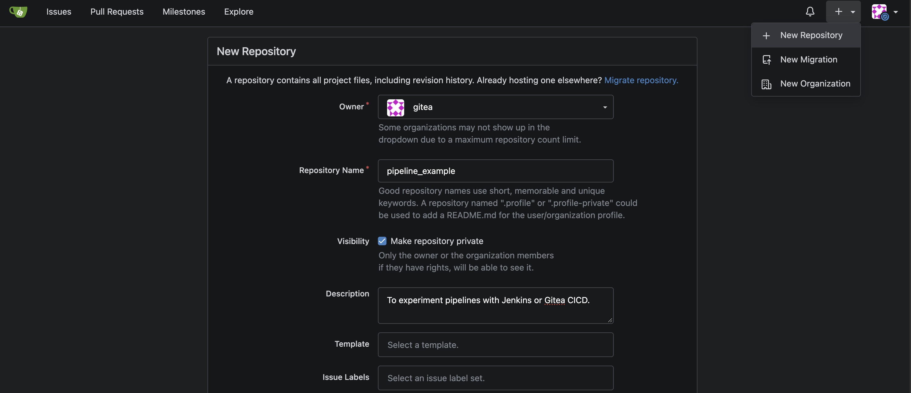
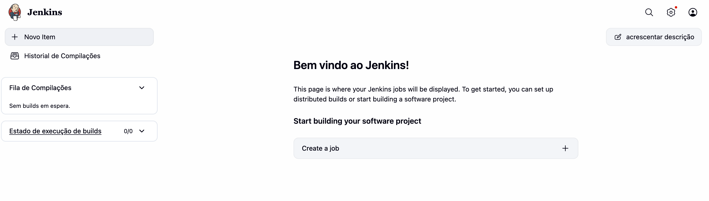
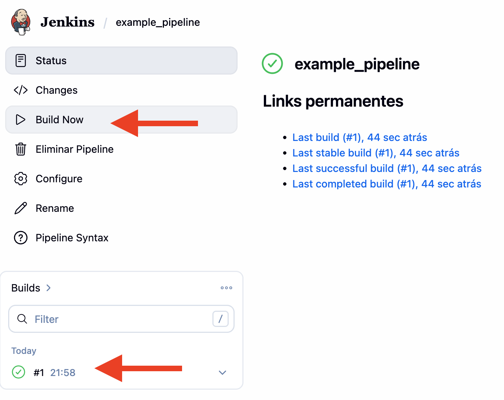
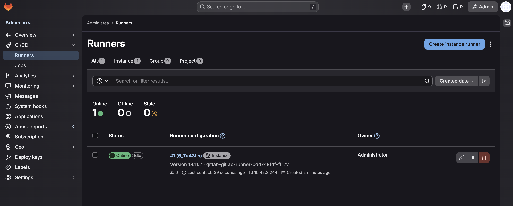
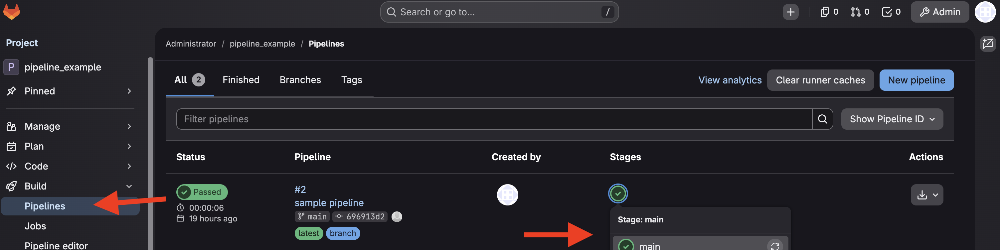
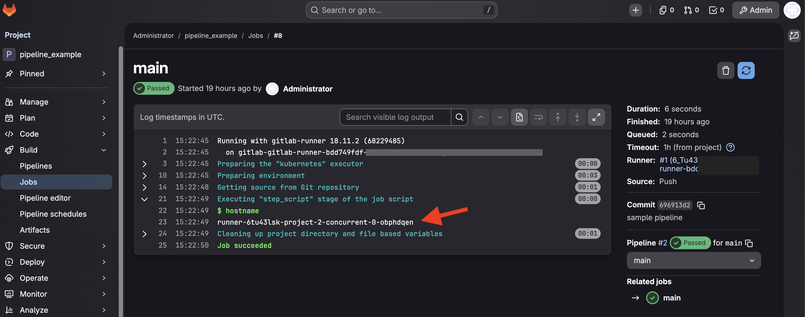
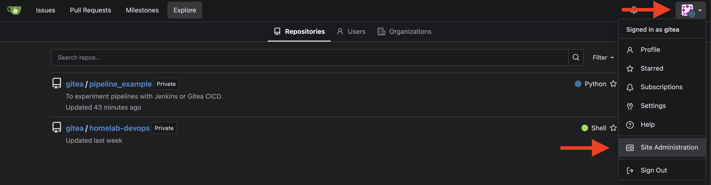
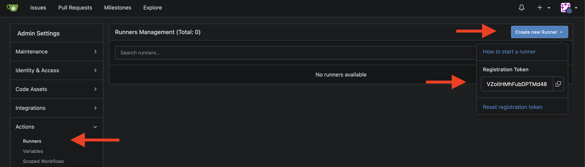
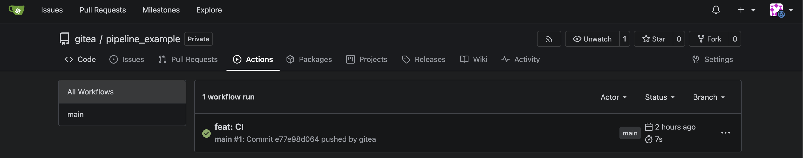
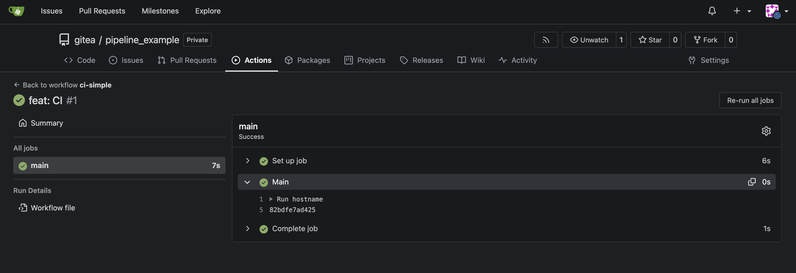

# Introduction

Now that I have git servers, a secrets manager and an image registry, I can start working on the CI part of my pipeline. In this article I will deploy three CI options and compare them to decide which one suits best my homelab: Jenkins, GitLab Runner (which executes the GitLab CI pipelines) and the Gitea Actions runner (which executes the Gitea Actions workflows).

A CI (Continuous Integration) tool is a very important part of a CI/CD pipeline. Every time someone pushes a change to a repository, it is responsible for at least checking out the code, building it, testing it, creating the container image and pushing it to the registry. Check the first article [1-Architecture_and_hardware (CI options)](./1-Architecture_and_hardware.md#ci-continuous-integration-so-when-a-new-commit-is-done-on-the-repos-the-workflow-runs) for the reasons of each choice, but here is the overview:

 - Jenkins
   - Industry standard, has a lot of plugins and it is very good for CI/CD.
   - Independent of the git server
 - Gitlab CI and GitLab Runner
   - Already part of GitLab, so it integrates well with Gitlab, both the repository and the registry
   - Uses Gitlab Runners to run the jobs
 - Gitea Actions and the Gitea runner
   - Same reason as GitLab, since it already has a registry and a git server, why not use the CI tool as well
   - Workflow and sintax is very similar to Github Actions, so it should be easy to move from Github repos to Gitea repos.

## What I will compare in this article

To compare the three CI tools, I will compare the following:

 - Resource consumption (CPU and memory) when idle
 - How simple it is to write the pipeline for the same simple example
 - How jobs are executed. How many pods does each one create to run the job?
 - Integration with Gitlab, Gitea, and Harbor
 - Create a simple CI pipeline that, from a repository on both Gitea and Gitlab, checkos out the code, builds an image and pushes to the registry, while fetching the credentials from OpenBao 

Whichever CI tool I choose, it will be part of my complete CI/CD pipeline that I will create in the [12 - CI/CD](./12-CICD.md) article.

# Pre-requisites

There are a few actions needed before deploying the CI tools:

 - Preparing the Reverse Proxy LXC (only Jenkins needs it, as the runners have no web UI)
 - Preparing the hosts file
 - Creating the admin secret for Jenkins
 - Creating Gitea and Gitlab tokens for Jenkins
 - Creating OpenBao approles for each CI tool
 - Creating Harbor robot accounts for each CI tool
 - Preparing a simple repository on Gitlab and Gitea for CI

## Preparing Reverse Proxy LXC so Jenkins is accessible

Like on the previous articles, I need to update the reverse proxy configuration to access the Jenkins web UI. The config is on [infrastructure/ansible/playbooks/update-reverse-proxy-config.yaml of my homelab](https://github.com/Joao-Andrade/homelab-devops/blob/v9/infrastructure/ansible/playbooks/update-reverse-proxy-config.yaml) and the new url will be:

 - http://jenkins.internal

To apply the change to the reverse proxy, I excuted the following command from the `management-node`, with the repository cloned:

```bash
# cd into infrastructure/ansible/playbooks
ansible-playbook update-reverse-proxy-config.yaml
```

## Preparing the hosts file

The computer that will access Jenkins needs the new hostname in its `/etc/hosts` file, if on a Mac or Linux machine. For windows it may be a dfferent method. Appended it to the line that already points to the reverse proxy IP:

```bash
192.168.1.81 jenkins.internal
```

## Creating the admin secret for Jenkins

In order to access Jenkins, it is necessary to have some admin account. This can be achieved on two ways. The simple one, that I do not recommend, is setting it on the values file of the Chart, [Jenkins helm chart folder on my repository](https://github.com/Joao-Andrade/homelab-devops/tree/v9/infrastructure/helm-charts/argo-deploys/stateful/ci/jenkins). The values on the values file are:

```bash
jenkins:
  controller:
    admin:
      createSecret: true
      username: "admin"
      # REPLACE the placeholder before deploying
      password: "<set-a-password>"
```

The other option, is to create manually a Kubernetes secret on the cluster, that will contain the credentials. That way, the creentials are not stored on git, even by mistake.

To create the secret, on the management node:

```bash
kubectl create namespace jenkins --kubeconfig ~/.kube/homelab_cluster01
# REPLACE the placeholder before deploying
kubectl create secret generic jenkins-admin -n jenkins --kubeconfig ~/.kube/homelab_cluster01 \
  --from-literal=jenkins-admin-user=admin \
  --from-literal=jenkins-admin-password=<password>
```

On the values file of the [Jenkins helm chart](https://github.com/Joao-Andrade/homelab-devops/tree/v9/infrastructure/helm-charts/argo-deploys/stateful/ci/jenkins/values.yaml), the following need to be set:

```bash
jenkins:
  controller:
    admin:
      createSecret: false
      existingSecret: jenkins-admin
      userKey: jenkins-admin-user
      passwordKey: jenkins-admin-password
```

Then when Jenkins is deployed, it will read from that secret.

## Gitea and Gitlab tokens for Jenkins

In order for Jenkins to connect to Gitea's and Gitlab's repositories and registries, it needs to have the necessary credentials and permissions to access them. So, I need to create tokens for each one.

To create access tokens on both Gitlab and Gitea, I followed the same approach I did on a previous article about deploying both git servers and [created an access token for each](./5-git_gitlab_vs_gitea.md#getting-gitlab-and-gitea-access-tokens).

I created the following Access tokens:

| Git server | Access token name | Permissions |
| --- | --- | --- |
| Gitea | jenkins-token | Repository -> read and write, Packages -> read and write |
| Gitlab | jenkins-token | Read_repository, write_repository, read_registry, write_registry, api, read_api |

## OpenBao approles for each CI tool

Because each CI tool needs to access external services on the cluster, for example, to the registry, it is necessary to have credentials. Instead of having those credentials hardcoded in the pipeline or in the CI tool configuration, I will use OpenBao to store the credentials. That way, the secrets and credentials are centralized and everything that needs a credential can just fetch from there and if a credential changes, I just need to update on Openbao instead of on all the necessary tools or pipelines.

This means that I need to create an OpenBao approle for each CI tool, Gitea CI, GitLab CI and Jenkins. To do that, from the management node, access OpenBao container (the CLI binary is `bao`):

```bash
# Enter OpenBao container
kubectl --kubeconfig ~/.kube/homelab_cluster01 -n openbao exec -it openbao-0 -- /bin/sh

# Export BAO_TOKEN
export BAO_TOKEN="<token>"

#---- Jenkins app role ----
# Create AppRole - read only policy
bao write auth/approle/role/jenkins-role token_policies=read-homelab-secrets token_ttl=1h token_max_ttl=4h
# Show role id
bao read auth/approle/role/jenkins-role/role-id
# Generate secret id
bao write -f auth/approle/role/jenkins-role/secret-id

#---- Gitea app role ----
# Create AppRole - read only policy
bao write auth/approle/role/gitea-ci-role token_policies=read-homelab-secrets token_ttl=1h token_max_ttl=4h
# Show role id
bao read auth/approle/role/gitea-ci-role/role-id
# Generate secret id
bao write -f auth/approle/role/gitea-ci-role/secret-id

#---- GitLab app role ----
# Create AppRole - read only policy
bao write auth/approle/role/gitlab-ci-role token_policies=read-homelab-secrets token_ttl=1h token_max_ttl=4h
# Show role id
bao read auth/approle/role/gitlab-ci-role/role-id
# Generate secret id
bao write -f auth/approle/role/gitlab-ci-role/secret-id
```

## Harbor robot accounts for each CI tool

In order for each CI tool to access HArbor to either pull or push images, it is necessary to create three Harbor robot accounts, one for Gitlab Runner, one for Gitea Runner and one for Jenkins. To do that, I followed the steps I wrote on the previous article about the registries on how to [create a Harbor robot account](./8-Registry_harbor_vs_git_registries.md#creating-a-robot-account).

I created the robot accounts:
 - robot$homelab-registry+gitlab-runner
 - robot$homelab-registry+gitea-runner
 - robot$homelab-registry+jenkins

Each of them has the permissions:
 - Artifact -> List and read
 - Repository -> List, push, pull and read
 - Tag -> Create and list

## Preparing a simple repository on Gitlab and Gitea for CI

In order to actually experiment and check which CI tool is better for my homelab, I will create a repository with some python code. The objective is that the CI tool will connect to the repository and whenever there is a change on the repository, it will build the image and push it to the registries.

I will create the same repository on both Gitea and Gitlab, because I will only use Gitea Actions with Gitea and Gitlab Runners with Gitlab. Jenkins will work with both repos.

The repository will contain the files I have on a sub folder of my [homelab repository](https://github.com/Joao-Andrade/homelab-devops/tree/v9/scripts/management-node/testing-apps/ci/test-repo) under the path `scripts/management-node/testing-apps/ci/test-repo`. So I just created a repository on both Gitea and Gitlab and copied the contents of the folder.

For both Gitea and gitlab, to create a new repository, clicked on the plus symbol and selected new repository. Then entered the project name and description and clicked create repository. For my comparison, the repository has the same name on both git servers, `pipeline-example`.

Gitea new project page:



Gitlab new project page:


# Deploying the CI tools on my Homelab

Like for the previous articles and deployments, I will use ArgoCD to deploy the CI tools, so I just need to copy each folder with the helm chart to the repository that ArgoCD is watching. All the charts, except for Gitlab runner, are in my [homelab repository](https://github.com/Joao-Andrade/homelab-devops/tree/v9/infrastructure/helm-charts/argo-deploys), under a `ci` category folder, and each one is a wrapper chart around the official one, with a `Chart.yaml` that references it and a `values.yaml` with the values I override.

Jenkins is deployed as a stateful application (`infrastructure/helm-charts/argo-deploys/stateful/ci/jenkins`), because everything that matters is stored in the Jenkins home (jobs, build history, configuration), so it is persistent to avoid any mistake on git to delete it. Gitea Runner is a stateless application (`infrastructure/helm-charts/argo-deploys/stateless/ci/gitea-runner`), because it does not need to have anything persistent. As of Gitlab runner, I could do the same as Gitea Runner, but since the Gitlab's Helm chart (`infrastructure/helm-charts/source-control/gitlab`) has the possibility to configure a Gitlab Runner, I decided to go that way for simplicity.

## Jenkins

### Creating the Jenkins helm chart

The Jenkins project has an [official helm chart](https://github.com/jenkinsci/helm-charts). My chart on my [homelab repository](https://github.com/Joao-Andrade/homelab-devops/tree/v9/infrastructure/helm-charts/argo-deploys/stateful/ci/jenkins) is based on that and then I override some values. As is, the Helm chart deploys Jenkins without any executors (builds run on Kubernetes agents), the admin credentials can be either from an existing Secret or from variables on values file, it has no TLS, is accessed through `http://jenkins.internal` and installs the Vault plugin so it can define job variables from OpenBao's secrets.

### Deploying Jenkins on the kubernetes cluster

First, I created the namespace and the admin Secret. Check the [Creating the secrets for Jenkins](#creating-the-secrets-for-jenkins) section.

Then copied the [Jenkins folder with the helm chart](https://github.com/Joao-Andrade/homelab-devops/tree/v9/infrastructure/helm-charts/argo-deploys/stateful/ci/jenkins) to the repository that ArgoCD is watching. For my homelab, as it is stateful, I copied it to Gitlab's repository, to `infrastructure/helm-charts/argo-deploys/stateful/ci/jenkins`. ArgoCD will notice the folder and deploy it on the cluster.

Once deployed, confirm the pods are running on the cluster. Jenkins downloads its plugins when it starts, so the first start can take a few minutes:

```bash
kubectl --kubeconfig ~/.kube/homelab_cluster01 get pods -n jenkins
```

### Accessing Jenkins

On the browser, accessed Jenkins through the URL `http://jenkins.internal`. To login I used the credentials created by the secret mentioned on the previous section.

 .

### Creating a simple pipeline on Jenkins
 
To confirm that Jenkins is working, I will create a simple pipeline on Jenkins that uses a pod to execute the pipeline. On Jenkins, to create a new `Pipeline`, clicked on the `New Item` at the top right corner.



Then on the pipeline creation page, selected `Pipeline` as the item type, entered `pipeline_example` as the name and clicked `OK`.


On the pipeline configuration page, I left most of the default values, except for the pipeline definition, which I selected one of the templates `Declarative (kubernetes)`. This pipeline, when executed, creates a pod on the cluster and executes the command `hostname`, which outputs to the console the pod name. This way, I make sure Jenkins can start pods on the cluster to execute pipelines.


When the pipeline is created, clicked on the `Build Now` button on the left side panel. After the build started, a new entry appears on the `Build` section to the left side panel.



To check the output, clicked on that entry and then on `Console Output` to see the logs. The logs of the pipeline shows that the pod was created and outputs the hostname, which is the pod name.


## GitLab Runner

For Gitlab Runners, there are two ways I can create them on the cluster.

I could use a Helm chart based on the [official helm chart for Gitlab Runner](https://docs.gitlab.com/runner/install/kubernetes/) and be it independent from Gitlab Helm chart. That way, every change to Gitlab Runner's configuration or Gitlab's configuration, will be updated independently. 

Another way, is using the Gitlab Helm Chart used to deploy Gitlab on the cluster. On the values file, there is the option to create the runners automatically. It is a simpler approach, but The downside is that if I want to change some configuration on the runner, I have to update the Gitlab Helm chart, which causes some downtime on Gitlab.

For simplicity, I choose the second approach, unless I decide later that I want to use Gitlab as the git server and Gitlab Runners as the CI tool.

### Deploying the GitLab Runner on the kubernetes cluster

To enable the Runner, I did the following changes to the values file, which is located on `infrastructure/helm-charts/source-control/gitlab/values.yaml` of my [Homelab repository](https://github.com/Joao-Andrade/homelab-devops/tree/v9/infrastructure/helm-charts/source-control/gitlab/values.yaml):

```yaml
gitlab:
  .
  .
  .
  gitlab-runner:
    install: true

    # Connect through the internal service
    gitlabUrl: http://gitlab-webservice-default.gitlab.svc.cluster.local:8181/

    # Max number of jobs running at the same time.
    # Each job is a pod, so for a homelab doesn't need much.
    concurrent: 2

    # Create the RBAC resources for the runner.
    rbac:
      create: true

    runners:
      config: |
        [[runners]]
          # Jobs clone the repository through the internal service.
          clone_url = "http://gitlab-webservice-default.gitlab.svc.cluster.local:8181"
          [runners.kubernetes]
            namespace = "{{.Release.Namespace}}"
            image = "alpine:3.20"
            privileged = false
            [[runners.kubernetes.host_aliases]]
              ip = "192.168.1.100"
              hostnames = ["gitlab.internal", "harbor.internal", "openbao.internal", "registry.gitlab.internal"]

    resources:
      requests:
        cpu: 50m
        memory: 64Mi
      limits:
        cpu: 200m
        memory: 128Mi
```

Because the runner is part of the GitLab Helm chart, deploying it means upgrading the GitLab release. From the `management-node`, inside the GitLab chart folder:

```bash
cd infrastructure/helm-charts/source-control/gitlab
helm upgrade gitlab . --kubeconfig ~/.kube/homelab_cluster01 --namespace gitlab
```

This restarts some GitLab pods, so GitLab is unavailable for a few minutes. Confirm the runner pod is running by running the command below on the `management-node`:

```bash
kubectl --kubeconfig ~/.kube/homelab_cluster01 get pods -n gitlab | grep runner
```

If it is running, to confirm on Gitlab UI that the runner appears as online on GitLab, I navigated to `Admin` button on the top left and then clicked on `CI/CD` -> `Runners` from the left menu.



### Creating a simple pipeline on GitLab

Since I already created a sample repository on GitLab to test it out (check ([Preparing a simple CI pipeline](#preparing-a-simple-ci-pipeline-on-gitlab)), I just need to create a `.gitlab-ci.yml` file on the repository. The pipeline of my simple example is similar to the one used on [Jenkins](#jenkins), meaning that it starts a pod with the same image and outputs the hostname.

```yaml
stages:
  - main

main:
  stage: main
  image:
    name: ubuntu
    kubernetes:
      user: "1000"
  retry: 2
  script:
    - hostname
```

When the file is uploaded to the repository, the pipeline starts automatically. To check the pipelines on the repository, I navigated to the `Build -> Pipelines` link on the left menu.



Then to check the output, clicked on the stages to show all the stages and clicked on the one I wanted to see the details of the job.



## Gitea Runner

The Gitea Runner project has an [official Gitea Actions Runner Helm chart](https://gitea.com/gitea/helm-actions). My chart on my [homelab repository](https://github.com/Joao-Andrade/homelab-devops/tree/v9/infrastructure/helm-charts/argo-deploys/stateless/ci/gitea-runner) is based on that and then I override some values. The relevant information to notice are:

 - It connects to Gitea through the internal service (`gitea-http.gitea.svc.cluster.local:3000`).
 - The registration token comes from an existing Secret `gitea-runner-token`.
 - The runner pod has two containers: the runner itself and a Docker-in-Docker sidecar, which is the one that runs the job containers. The Docker-in-Docker container runs privileged, which is a security trade-off that I accept on a homelab, but that should be reevaluated on a production environment.
 - Like on the GitLab Runner, the host aliases so the job containers can resolve the `*.internal` names.
 - Resource requests and limits for both containers.

### Creating the registration token secret

The runner registration token is not stored on the values file, so it is not on git. In order for the runner to know the registration token, it needs to be a secret on the cluster.

To fetch the token, on Gitea, clicked on the profile icon on the top left corner and clicked on `Site Administration`.



Then on the left side menu, clicked on `Actions` -> `Runners`. On the page near the top to the right, should appear a button `Create new runner` if clicked there, should appear the registration token.



Then from a computer with access to the cluster, created the namespace and the Secret:

```bash
kubectl create namespace gitea-runner --kubeconfig ~/.kube/homelab_cluster01

kubectl create secret generic gitea-runner-token -n gitea-runner --kubeconfig ~/.kube/homelab_cluster01 \
  --from-literal=runner-token=<registration-token>
```

### Deploying the Gitea Actions runner on the kubernetes cluster

To deploy the Gitea Actions Runner Helm chart, I copied the [Gitea Runner folder with the helm chart](https://github.com/Joao-Andrade/homelab-devops/tree/v9/infrastructure/helm-charts/argo-deploys/stateless/ci/gitea-runner) to the repository that ArgoCD is watching. For my homelab, since it is stateless application, I copied it to Gitea's repository, to `infrastructure/helm-charts/argo-deploys/stateless/ci/gitea-runner`. ArgoCD will notice the folder and deploy it on the cluster.

Once deployed, confirm the pods are running on the cluster:

```bash
kubectl --kubeconfig ~/.kube/homelab_cluster01 get pods -n gitea-runner
```

### Creating a simple workflow on Gitea

Since I already created a sample repository on Gitea to test it out (check ([Preparing a simple repository on Gitlab and Gitea for CI](#preparing-a-simple-repository-on-gitlab-and-gitea-for-ci)), I just need to create a `.gitea/workflows/test.yaml` file on the repository. The workflow of my simple example is similar to the one used on [Jenkins](#jenkins) and [GitLab](#gitlab), meaning that it starts a pod with the same image and outputs the hostname.

```yaml
name: main
on: [push]

jobs:
  main:
    runs-on: ubuntu-latest
    container:
      image: ubuntu
      options: --user 1000
    steps:
      - name: Main
        run: hostname
```

To check the pipeline or workflow status, on the repository page, clicked on the `Actions` tab. There it is possible to see all the workflows and their status.



From the list, I clicked on the one I wanted to see the details of the job. From the page, it is possibble to see each stage of the workflow and if clicked on any of them, it is possible to see the console output of the job.



# Comparing the CI tools

In this section I will describe the comparison of the three CI tools. I will compare the resource consumption of each one when idle, create a workflow for each that builds and pushes an image to the registry, while fetching credentials from OpenBao, for example to push to Harbor. I will also take into consideration the complexity of each pipeline or workflow and how easily it integrates with the different registries and git servers (GitLab Runner -> Gitlab, Harbor and Openbao; Gitea Actions Runner -> Gitea, Harbor and Openbao; and Jenkins -> Gitlab, Gitea, Harbor and Openbao).

## Resource consumption

To compare the resource consumption, when Idle, I let Jenkins, Gitlab Runner and Gitea Actions Runner applications running for 1 hour. This doesn't tell much about the performance, as they are idle, but it is interesting to understand how much resources it consumes from the cluster when there is no pipeline or workflow to execute. Since all of them have resource limits configured for when a pipeline or workflow is running, it is not necessary to compare that. To get the resource consumption of the CI tools, I ran the following command from the `management-node`:

```bash
kubectl top pods -A --kubeconfig ~/.kube/homelab_cluster01
```

This returns the memory and CPU usage by all pods on the cluster. Regarding the registries, here are the results:

| CI Tool | Pod | CPU (cores) | Memory (Mi) |
|----------|-----|-------------|-------------|
| Gitea Runner | gitea-runner-runner-0 | 2m | 86Mi |
| Gitlab Runner | gitlab-gitlab-runner-xxxx-xxxx | 9m | 25Mi |
| Jenkins | jenkins-0 | 2m | 747Mi |

As it is possible to see, Jenkins consumes way more memory than Gitea Runner or Gitlab Runner, but that is not suprising, as Jenkins is a full application while Gitea Runner and Gitlab Runner are only the runners of each git server. The better comparison with Jenkins would be against both Git runners and git Servers, although that would not be entirely fair as well, because they serve different purposes, while having a part dedicated to running pipelines.

Since I already have the resource consumption of Gitlab and Gitea from the previous article about [Comparing Gitlab vs Gitea](./5-Git_gitlab_vs_gitea.md#resource-consumption-baselines), I can estimate how much resources each Git consumes with it's Runner (I could use the last article where I have the comsumption of each Git server with the registry enabled, but because  it is possible that I use Harbor instead, I cannot take that into account here).

| Tool | CPU (cores) | Memory (Mi) |
|----------|-------------|-------------|
| Gitea and Gitea Runner | 10m | 207Mi |
| Gitlab and Gitlab Runner | 150m | 3108Mi |
| Jenkins | 2m | 747Mi |

Now the results are a bit different. Gitlab consumes way more resources than Gitea and Jenkins, while Gitea continues to be the most resource-efficient package. But that does not decide anything, I need to compare next how easy it is to create pipelines or workflows, the steps to integrate with the git servers and their registries (for Jenkins), Harbor registry and OpenBao and which tool has the better experience, for my homelab.

## Simple workflow on each tool

On the previous section about [Deploying each CI tool on the cluster](#deploying-the-ci-tools-on-my-homelab), I created a simple workflow that runs a pod with the same image and outputs the hostname. Because it is a very simple workflow, all of them were relativly easy to configure.

## How many pods each workflow / pipeline creates

This is completly configurable when deploying each Runner and Jenkins, meaning a pipeline can start one or more pods, depending on the configuration that can be changed on the Helm chart values file of each CI tool.

## Integration with other tools

On this section I will explain the steps necessary to integrate each CI tool to other tools on the cluster. This means that Jenkins needs to be able to connect to Harbor, OpenBao and Gitlab's and Gitea's repositories and registries. Gitlab Runner and Gitea Actions Runner need to be able to connect to Harbor, OpenBao and the respective Gitlab/Gitea's repositories and registries.

To facilitate this section, on the [Pre requisites](#pre-requisites) section, I already prepared OpenBao's approles and Harbor's robot accounts for each CI tool as well as Gitlab and Gitea tokens for Jenkins to access their repositories and registries.

### Jenkins integration to other tools

In order to Jenkins to be able to connect to Harbor, OpenBao and Gitlab's and Gitea's repositories and registries, it needs to have the necessary credentials and permissions to access them. I will describe how to configure each integration.

#### Jenkins integration to each Git server


### Gitlab Runner integration to other tools

### Gitea integration to other tools

## Workflow that builds and pushes images to registry


## Conclusion

> **TODO (me):** my conclusion. Some points to cover, based on what the comparison shows:
>
> - Jenkins is independent of the git server, so it keeps working whichever git server I choose, and it has the most plugins, but it is a separate application to deploy, secure and keep updated, and it is the heaviest.
> - The GitLab Runner and the Gitea Actions runner are very light, as they only run jobs, and the pipeline lives with the code, but they tie the CI to that git server.
> - What I would pick for the homelab, and whether the choice depends on the git server and registry decision from the next article.

I will not make the final decision in this article, because it depends on the combination of git server, registry and CI tool. That is what the next article is about.

# Cleaning up the CI tools

The steps are similar for Jenkins and the Gitea Actions runner, which are deployed via ArgoCD: first remove the folder from the repository and wait for ArgoCD to sync. The stateless chart (Gitea runner) is fully removed by ArgoCD, except the namespace and the Secret I created by hand, but Jenkins is stateful, so ArgoCD removes the application but leaves the resources on the cluster, and they need to be removed by hand. The GitLab Runner is part of the GitLab release instead, so it is removed through Helm.

## Cleaning Jenkins

From the `management-node`, with the repository cloned:

```bash
# Check what is left
kubectl --kubeconfig ~/.kube/homelab_cluster01 -n jenkins get all,secrets,pvc,configMaps

# Check resources not in the namespace:
kubectl get clusterrole,clusterrolebinding --kubeconfig ~/.kube/homelab_cluster01 | grep -i jenkins
```

Delete every resource the previous commands show that belongs to Jenkins. After that, remove the namespace, which also removes the Jenkins home volume and the admin Secret:

```bash
kubectl --kubeconfig ~/.kube/homelab_cluster01 delete namespace jenkins
```

## Cleaning GitLab Runner

The runner is part of the GitLab release, so to remove only the runner set `gitlab-runner.install` back to `false` in the GitLab values file and upgrade:

```bash
helm upgrade gitlab . --kubeconfig ~/.kube/homelab_cluster01 --namespace gitlab
```

It is removed together with GitLab when GitLab is cleaned (check [Cleaning Gitlab](./5-Git_gitlab_vs_gitea.md)).

Then, on GitLab go to `Admin Area` -> `CI/CD` -> `Runners` and delete the runner, so it does not stay registered. If the `.gitlab-ci.yml` file is not needed anymore, remove it from the repository.

## Cleaning Gitea Actions runner

```bash
kubectl --kubeconfig ~/.kube/homelab_cluster01 -n gitea-runner get all,secrets,pvc,configMaps
kubectl --kubeconfig ~/.kube/homelab_cluster01 delete namespace gitea-runner
```

Then, on Gitea go to `Site Administration` -> `Actions` -> `Runners` and delete the runner. If the workflow file is not needed anymore, remove it from the repository. Gitea can keep Actions enabled, as it has no cost when there are no runners.

# Next steps

Now that I tested the CI tools, I have all the components to decide which git server, registry and CI tool to use on my homelab. Check the next article [10 - Git server, registry and CI tool: the decision](./10-Git_registry_ci_tool_the_decision.md).

# Articles

Here's the full list of articles of this series:

 - [1 - Architecture and Hardware](./1-Architecture_and_hardware.md)
 - [2 - Install Proxmox](./2-Install_proxmox.md)
 - [3 - Create and configure LXCs](./3-Create_and_conf_LXCs.md)
 - [4 - Create and configure VMs](./4-Create_and_conf_VMs.md)
 - [5 - Git: Gitlab vs Gitea](./5-Git_gitlab_vs_gitea.md)
 - [6 - Deploy ArgoCD](./6-Deploy_argocd.md)
 - [7 - Secrets: Deploy OpenBao](./7-Secrets_openbao.md)
 - [8 - Registry: Harbor vs git registries](./8-Registry_harbor_vs_git_registries.md)
 - [9 - CI tools: Jenkins vs git runners](./9-CI_tools_jenkins_vs_git_runners.md)
 - [10 - Git server, registry and CI tool: the decision](./10-Git_registry_ci_tool_the_decision.md)
 - [11 - Code quality: Sonar, Trivy, Semgrep](./11-Code_quality_sonar_trivy_semgrep.md)
 - [12 - CI/CD](./12-CICD.md)
 - [13 - Observability: Grafana, Prometheus, Loki, Jaeger, SigNoz](./13-Observability_grafana_prometheus_loki_jaeger_sigmoz.md)
 - [14 - Conclusions](./14-Conclusions.md)
